# 归藏 · weread-guizang

把微信读书的书籍以 md 格式导出到本地，也把外部内容（公众号文章、知乎 / 小红书 / X 的帖子、RSS 订阅、视频）与安娜的档案下载的书收进同一个本地书架：整本导出为 Markdown、本地多格式阅读器，外加一个 AI 只搭手不代笔的写作台，每本书还能定一份阅读计划。

## 方案

归藏把微信读书那套只服务 AI Agent、且只读的接口还原成可用的本地工具，并补齐它没有的部分：

- 官方 Gateway 提供的数据，做成本地网页界面：书架、书城搜索、书籍详情、阅读统计、推荐、全部划线与想法。
- Gateway 不提供的功能——正文导出、图片下载、把书加入书架——复用登录态直接调用网页端接口。
- 面向 Agent，除界面外另提供一套零依赖的 MCP 适配器（61 个工具）。

三项能力都在本机完成，服务只监听 `127.0.0.1`，不经第三方服务器。

## 它可以做什么

一句话：**把「读写」这件事的产出——正文、划线、想法、笔记、导图、画板，以及你自己写下的稿子——都落到你自己的文件夹里**，顺带把你在别处读的东西（公众号、知乎 / 小红书 / X、RSS 订阅、视频）和你在别处记的东西（flomo 导出的便签）也收进同一个本地书架。

**1.1.0 要点**：阅读 AI 走独立配置（`ai_*`，与小 Agent 分开）、氛围渐变可自定义、小结进右栏第三页、视频转笔记改为学生向布局；第二轮再加**顶端正中的「AI 导航」与内置浏览器**（`ai-bot.cn` 与安娜的档案都能在软件内直接看）、**便签改成 memos 两栏**、**推荐页只留六本**，并把**切页一致性**（每屏同一块舞台，不再左右横跳）与**小 Agent 的回话形状兼容**一并收口。

**1.2.0 要点**：**剪藏**顶部撤掉输入框，改一颗**手指圆钮**——复制链接点一下，自动读剪贴板、解析正文，外圈一圈环形进度走满正好解析完，收尾弹「解析已完成」；**视频转笔记**把长视频转写读取改成分页 + 解析缓存（翻屏不再付全量代价）、进度条实时跟着转写日志走、刷新后「转写中」条目留在架子上、**停止按钮点一下立刻停**；**思维导图**放宽节点间距并放大整体尺寸、用**双指触控缩放**替代右上角加减号；**便签**左栏换成**富文本编辑器**（工具条即所见即所得），复制粘贴与「复制」按钮导出都保留 **Markdown**；另修好**微信书架部分远端封面**因 Referer 被图床拒掉、加载不出来的问题。

**1.2.1 要点**：**取书**这一路修了两件事——先修好「取书卡住」（引擎进程退了、孙进程还攥着输出管道，任务状态永远钉在「正在取」，现在进程一退最多再等两秒就收尾），再放开「**取多少都能先读**」（盘上已有章节就先给「阅读」，旁边并一颗「续取」，不必等整本取完）；**思维导图**的小框按逐字像素算宽高，长文字完整显示、不再挤压；**叠卡**快速切书不再卡顿闪烁（合成层只在翻动那一下临时提起，位置没变的卡整段跳过，批尾补卡改成去抖）；**控件整体加了一层质感与统一反馈**（动效令牌、按压缩放、键盘焦点描边、落点涟漪、卡片入场、成功回弹，且尊重系统「减少动态效果」）；**划线笔记**从列表改成**书籍卡片瀑布流**，并把**取书时在本机划的线**并进来一起展示；**随机漫步**同样支持抽本机读书笔记；**安娜的档案**砍到只剩搜索框与搜索键，输入书名点搜索或回车直接跳转；**为我推荐**现在能把推荐的书**加入微信书架**（写回微信读书并同步）。

**1.2.2 要点**：**内置浏览器**里 YouTube 那一页不再是一片空白——它那台纯客户端应用在 iframe 的隔离沙盒里一碰存储就抛，现在由归藏自己读 `var ytInitialData` 铺成一页静态目录，每支旁边挂一颗「转成笔记」直接回视频那屏开跑；它未登录时的首页 / feed 连那坨 JSON 里都不放内容，所以认不出卡片时归藏会再换一处有货的落脚点，不再给一页空的；**视频转笔记**砍掉「先识别、再点转笔记」那一步，改成与剪藏共用同一颗**手指圆钮**，点一下就是「认链接 + 开跑」一条道走到底，进度收在外圈那道环上，那一屏的布局也整体收简；**换屏**统一落回开头，不再上下闪一下要人滚回去；**叠卡**左右切页不再让底部页码压在书上；**订阅 / 视频**那两栏输入框一行起步、跟着内容自己长，长链接不再被挤成一团；**搜书**那一屏搜到的书也能**加入微信书架**；另有一批读口与路由的收口：划线笔记、视频转笔记的脏回包、POST 路由漏接都各自补了离线门禁。
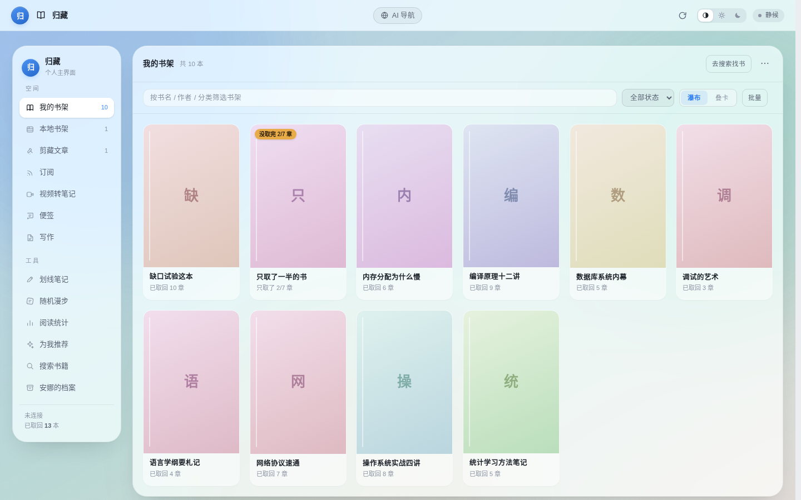

**取书与导出**

- 微信整本导出为 Markdown：文字与插图按阅读顺序交错，插图并发下载、逐章落盘，断了能接着续。
- **取多少都能先读**（1.2.1）：盘上已有章节就先给「**阅读**」，取到一半旁边并一颗「**续取**」，从没取过才是「取书」；详情页同理（先「阅读」，再「接着取 / 清掉重取」）。
- **取书不再卡住**（1.2.1）：引擎进程一退，任务最多再等两秒收尾，不再因为孙进程攥着输出管道而把状态永远钉在「正在取」。
- 导出 EPUB / PDF；也可只把划线导成 Anki 卡包（`.apkg`）。
- 书城搜索、书籍详情、作者与出版社、阅读进度与最近阅读时间，都在本地看，不必打开微信读书。

**搜书：微信读书书城**

- 搜索那一屏搜的是微信读书书城：每张卡下方都挂着那颗「**加入书架**」（和「为我推荐」、详情页走的是同一份逻辑，搜到的书也能直接写回微信读书书架并同步），点一下把书收进我的书包，再回书架整本取回；已经在架上的显示「已在书架」并禁用。
- 想直接下载一份文件到本地，用左侧导航最下面那一栏「安娜的档案」。

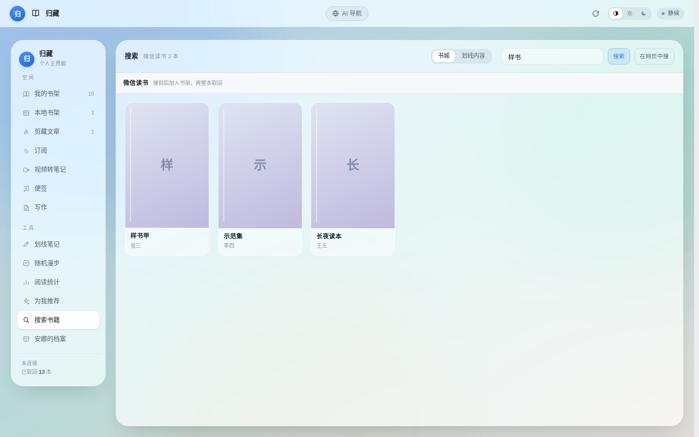

**为我推荐**

- 一排六本书，点开就是详情；每张卡下方那颗「**加入书架**」直接写回微信读书书架（和详情页那颗同一套），已经在架上的显示「已在书架」并禁用（1.2.1）。
- 数据是官方推荐 + 拿书架里一本做种子补齐到六本，两趟并发，开这一屏不用干等第二趟。

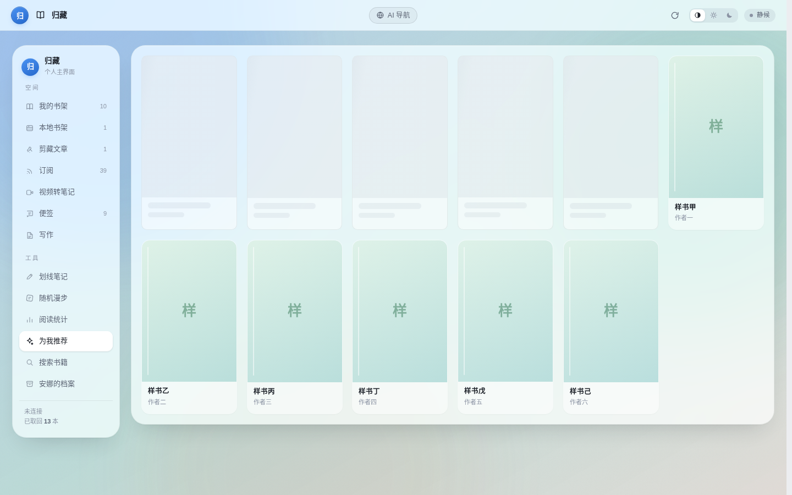

**安娜的档案：只留一个搜索框**

- 这一栏砍到只剩**一个搜索框 + 一颗搜索键**（1.2.1）：写个书名，点搜索或直接回车，归藏自己起一个浏览器窗口，把安娜的档案的**搜索结果页**领到你面前——翻页、登录、点下载都在那个真网页里做，跟平时上网没区别。
- 你在窗口里点下载，归藏在后台盯住下载夹：接住落进来的文件，认出格式就转成书收进「本地书架」，跟你自己导入的书走同一条路。
- 只收阅读器读得动的格式（EPUB / PDF / TXT / MD）：MOBI、AZW3、DJVU 一律不入库，原文件留着不动。
- 对方现在要先登录才给下载，所以第一次得在那个窗口里自己登一次；登录态只存在本机那个浏览器档案（`cache/anna_profile/`）里，归藏不读它，设置里的「清除本地数据」会连它一起清掉。
- 为什么做成窗口、而不是把那一页嵌进来：对方响应头写着 `X-Frame-Options: SAMEORIGIN`，iframe 一律空白；而它的域名字面在轮换、直连时常 TLS 断——只有真浏览器能稳定走完它自己的流程。所以这颗按钮要等浏览器组件就绪（没就绪时设置里点「修复」）。

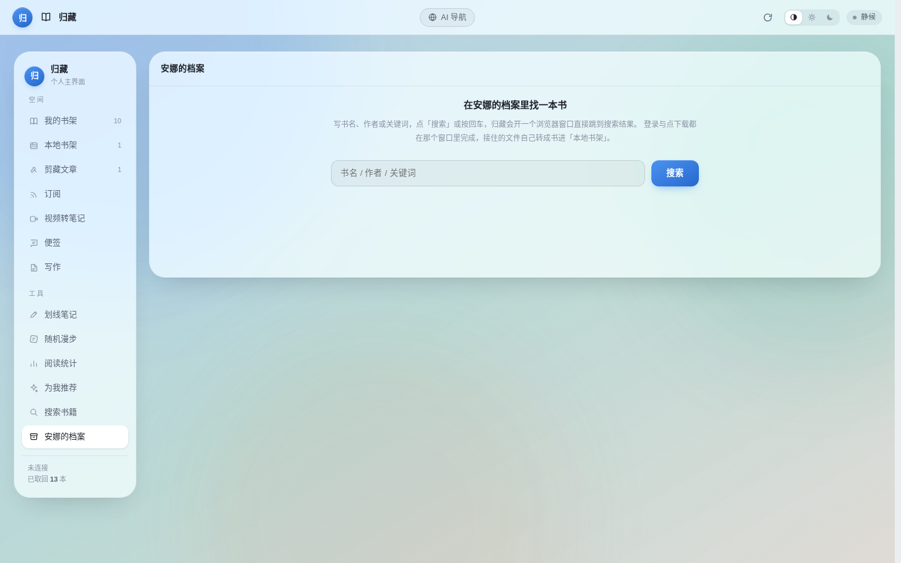

**本地阅读器**

- 取回的书直接在界面里读：左右分栏、目录随滚动高亮、键盘翻章。
- 重开一本书回到上次停下的**那一行**，不只是回到那一章。
- 本章「大纲」列出这一章的小标题，点一条就滚过去。
- 自行导入的 Markdown / TXT / EPUB / PDF 用同一套交互读。

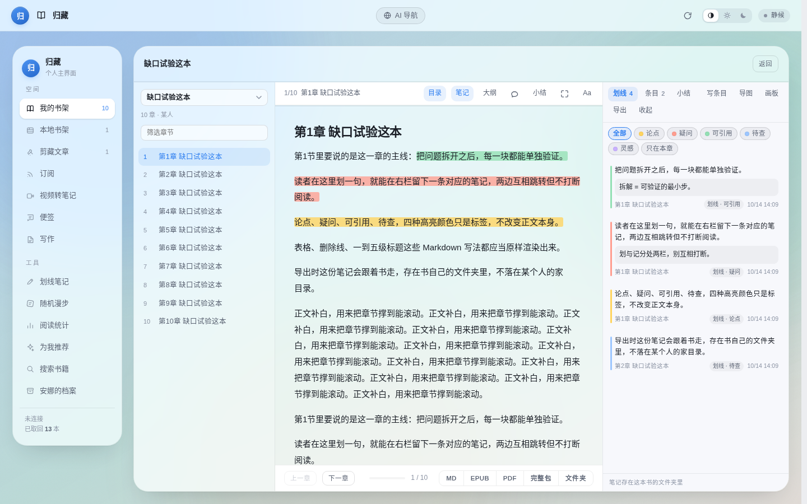

**每本书的阅读计划**

- 给一本在读书定个节奏：**每天读几页**或**每周读几页**，起读日一算，就知道按这个节奏哪天能读完，还剩多少页也随时看得到。
- 「一页」锚在正文本身（每 1000 字算一页），跟你的字号、窗口宽度都无关——今天明天是同一个数，「稳定的节奏」才立得住。
- 进度只记**只增不减的高水位**：翻回上一章查一个词，位置往回走了，「今天读了 30 页」也不会缩水成 8 页。
- 阅读器底栏实时显示今日读数与还剩多少，读到哪一页心里有数。
- 读完那一刻自动留一份完整记录（当时的目标、起止日期、一共读了几天），之后再定新计划也不会把它冲掉——给每本书一个交代。

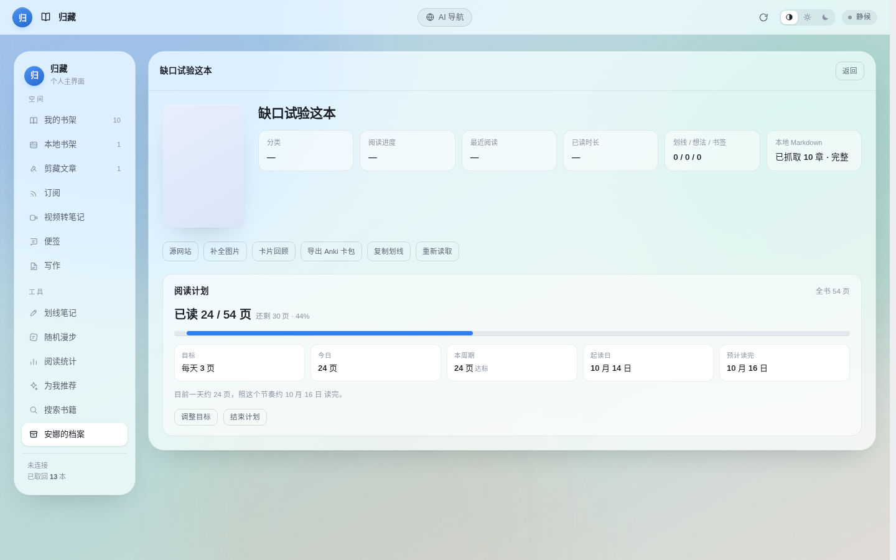

**边读边记**

- 正文里选中一段就能高亮、加粗、划线、删除线或写批注；右侧笔记与正文互相跳转，读到哪条一点就回到原句。
- 划词即记：选中后在浮层里直接写想法，保存时自动带上原文与位置。高亮分五色，颜色标的是「这句我打算怎么用它」——论点 / 疑问 / 可引用 / 待查 / 灵感。
- 随手划的一笔（轻量、成批）与独立笔记条目（可以很长、能引用书里别处）分开存。
- 笔记写在这本书自己的目录里（`notes.json` / `notes.md` / `mindmap.json` / `boards/`）：**拷走书就等于拷走笔记**，不进数据库。
- 官方读书笔记模板起手，也能把自己写的一篇存成模板。
- 阅读中划句问 AI：选中一段就地弹出「复制 / 译成中文 / 问小助手」；英文正文单击一个单词直接弹释义。

**划线笔记与随机漫步**

- 划线笔记这一屏从列表换成**书籍卡片瀑布流**（1.2.1）：一本一张卡，封面、书名、作者、来源徽章都在卡上，列数随窗口宽窄在 3 / 2 / 1 之间自适应。
- **两个来源并进同一面墙**：微信读书的官方划线与想法，加上**取回来的书里自己在本机划的线**——同一本书两边都有就并成一张卡，点进去两边的条目按时间倒序混排，各自带来源标签。
- **随机漫步也支持本机读书笔记**：顶栏「全部 / 微信 / 取书」三档任选，抽到的卡上那枚来源标签换色；只有微信读书索引时照旧能玩。
- 勾选、批量转 flomo、导出 CSV 这套功能对两个来源一视同仁。

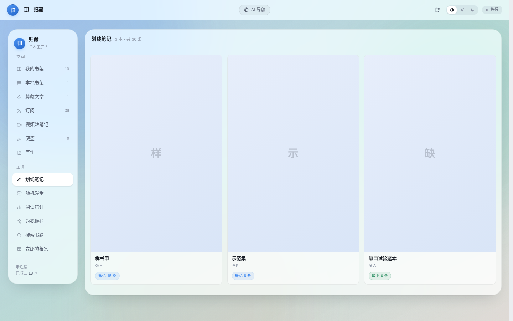

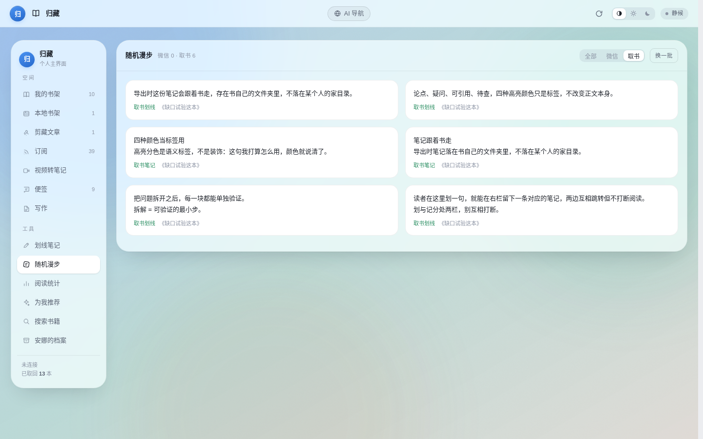

**笔记脑图与画板**

- 可编辑思维导图：四种形态（括号图 / 辐射图 / 鱼骨图 / 概念图），就地改名、加层、折起、连一条带关系词的线，撤销 / 重做 / 适应都在。坐标由后端算，拖过的位置钉得住；能复制成 Markdown 大纲，也能存一份 SVG。
- **缩放用双指**：右上角那对加减号已经撤掉，改成**双指触控缩放**——触控板两指捏合、触摸屏两指捏合都能绕手势中心放大缩小（手指按住的那块内容不会跑），单指滚动照常不抢；「适应」那颗钮仍在，一键缩到能看全。
- **节点不再挤在一起**：节点间距放宽、画布整体尺寸放大，长文字节点不再互相压叠；换形态、展开折叠都按新尺寸重新排版。
- **小框对文字自适应**（1.2.1）：框的宽高按逐字像素量出来，长句完整显示、不再被压成看不清的一团，也不截断。
- **叠卡快速切书不卡**（1.2.1）：合成层只在翻动那一下临时提起，位置没变的卡整段跳过，批尾补卡改成去抖——连翻十几本不再掉帧闪烁。
- **画板是一整屏的工作台**（1.2.2）：不再是一张居中小卡。左边常驻——这一本书的板在下面，「换一本书」点一下就切过去；右边是一张 3200×2200 的大纸，比任何窗口都大，所以它是**无限画布**：按住拖动、触控板双指、滚轮三种方式都能把画布挪到任何地方，⌘/Ctrl + 滚轮绕手势中心缩放。挪的是视口，纸上的笔不动——窗口变大变小，画的东西按原坐标留着，不会被挤成一团。
- **边读边写**：左栏点书名，书的正文就浮在画布右下角（可收，不挡笔），一边读一边在画布上记想法，记完点「并进笔记」落成这本书的一条带图笔记。
- **工具条全是图形**：笔、荧光笔、直线、箭头、方框、圆、文字、橡皮、选择，撤销 / 重做 / 清空、回原位、按内容置中，五种纸面 —— 全是图标，一个字不占；鼠标悬上去才出说明。
- 存的是「这块板」而不是「我此刻盯着哪儿」：视口永远不进存档，重开一块板回到它的左上角，而不是把你扔回上次挪到的角落。
- 用的是随包带的 fabric.js，不连 CDN。

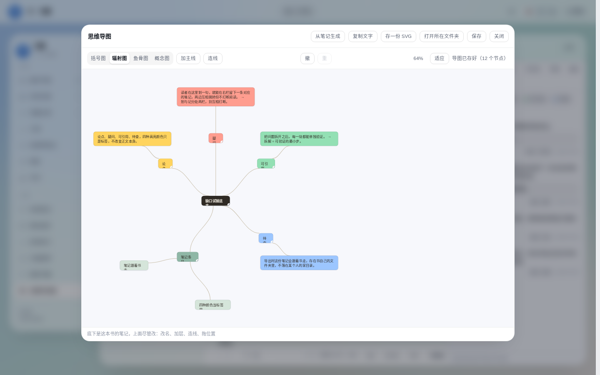

**书架**

- 六格各自独立：**读书**（微信读书）、**本地书架**、**剪藏**、**订阅**、**视频**、**便签**——一篇文章只落在它自己那一格，别处搜不到、翻不到。**写作**不住在这排芯片里，它自己一整屏，但稿子照样住在同一个书库。
- 每格有自己的文件夹、状态标签、标签和排序：给公众号建的「随笔」夹子不会出现在整本书的分组里，挪剪藏的顺序也不带动微信读书那一堆。
- 每页右上角的三点菜单里都能新建文件夹、改分类、给这一页的东西打标签。
- 两种摆法：**瀑布**（羊皮卷逐张展开）与**叠卡**（放大成一本书，左右像折叠屏那样张合，方向键直接翻；两侧各摊三张，左右都能点）。
- 与微信读书的书架分开显示，集中列出已取回与自行导入的书；一键定位到文件所在位置。
- 落在硬盘上也是分开的：`~/Documents/归藏/` 下按这**七**格各一个文件夹（写作那格装你的稿子），访达里一眼能认出哪本是从哪来的。
- 剪藏拿文章首图当封面，视频拿视频封面当封面——挑图时避开页头 logo 与头像，不会满书架一张脸。
- 书封面来自微信读书图床等外站时，界面会给图片带上 `no-referrer`（协议相对地址补成 `https`）：图床看 Referer 时不会再把本机来路当成陌生站点而回 403，此前「部分封面加载不出来」的那批书现在照常显示。
- **封面滚到眼前才去取**（1.2.2）：瀑布一批 60 本而一屏只放得下十几张，图地址先暂在卡片自己身上（`data-cover`），挂进文档、真滚到视口里才赋给 `` —— 在还没进文档的节点上赋 `src` 会让 `loading="lazy"` 形同虚设，进一次书架就是几十个封面请求同时砸出去。藏起来的那一屏一律不点亮，滚动、改窗口大小、切回书架都从同一条路上补一次。

**剪藏**

- **复制链接，点一下那颗手指**：顶栏不再放常驻的粘贴输入框，只有一颗带手指图标的圆钮。复制好文章链接后点它，归藏自己读剪贴板、填上链接、自动开始解析正文——整个过程只用这一下。
- 解析时圆钮外圈有一圈**环形进度**慢慢走：走满一圈正好是解析收尾，完成后弹框提示「**解析已完成**」，文章已经出现在下方列表里等着入库。
- 浏览器不放行读剪贴板时（例如非 `127.0.0.1` 打开）会弹出**一栏手动粘**的退路，而不是在屏顶塞一个常驻输入框。
- 粘贴微信公众号推文链接就能解析正文、进书架、按取书那套分章与目录读，导出 EPUB / PDF、定位文件同样可用，读完还能点回原链接。
- 知乎 / 小红书 / X 各有专门解析：X 能直接取正文；知乎与小红书未登录时常只回「安全验证」页——归藏如实说拿不到，**不会把验证页当正文存进书架**。

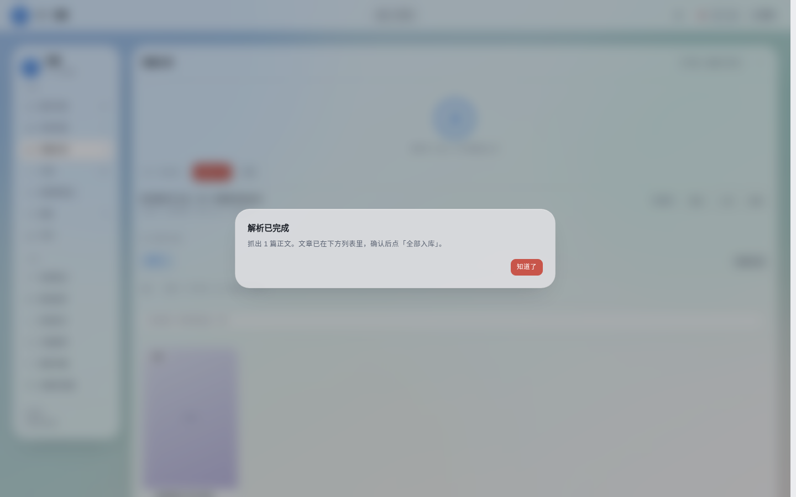

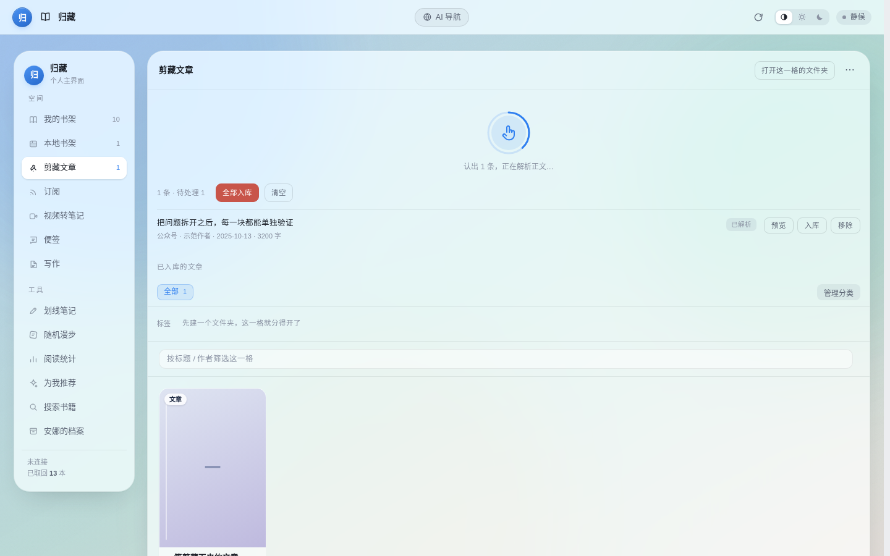

**订阅阅读器**

- 一个三栏的阅读器，不是一张订阅列表：左栏管源（分组、改名、退订、刷新进度），中栏是条目（未读 / 全部 / 本组 / 按标签筛，加搜索、勾选批量、标签片点开就改），右栏直接读正文。
- 粘站点首页也行：会自己从 `<link rel="alternate">` 里挑最好的那个源，RSS / Atom / JSON Feed 都认。
- 条目多了有「再来一批」；轮询只补需要变的那几行，不会把你正读着的第 30 条拽回顶上。
- 单条一键入本地书架；整包 OPML 导入导出；清理先报数再动手，删完还能撤。

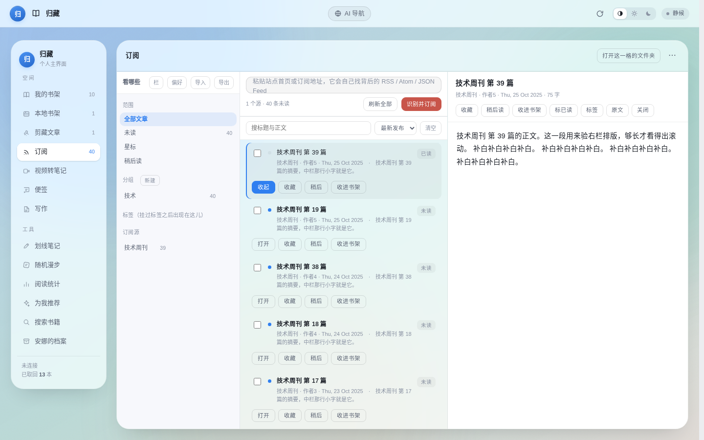

**视频转笔记**

- **顶栏两扇门**：这一屏最上面右侧是「**哔哩哔哩**」「**YouTube**」两颗入口，点开就在归藏自己的**内置浏览器**里逛（与「AI 导航」同一套 `/api/browse`），不必跳去系统浏览器；逛到想转的那条，点卡上那颗「**转成笔记**」就回到这一屏并把链接接进输入框（YouTube 那一页是归藏自己铺的静态目录，见下文「外站那一页」那条）。
- **一根手指，点一下就跑**：这屏砍掉了「先识别、再点转笔记」那一步——和剪藏共用同一颗**手指圆钮**，链接贴进来（或点手指从剪贴板取）按下去就是「认出链接 + 开跑」一条道走到底，进度收在手指外圈那道环上，中间不再要你点第二次确认。
- 贴 B 站 / YouTube 链接：取音频 → 你填的云端转写接口转文字 → AI 归纳成笔记与思维导图 → 当成一本书落进书架，之后跟取回的书一样读、一样记。
- **转写只走云端**：填一个兼容 OpenAI 的语音转写接口地址与 Key 就能用，本机不装引擎、不下权重、不占那几个 GB。没填时视频页那盏灯会写明「云端转写未配置」，旁边那颗钮直接把你送到设置里那一段。
- 多 P 视频只转你点的那一 P，界面上写清是哪一 P；音频只落临时目录，转完即清。
- **长视频翻屏不卡**：转写文本按段分页取，读取层直接把切片切好；同一份 `transcript.json` 按「大小 + 修改时间」缓存解析结果，翻页不再每次都把整份 JSON 重 parse 一遍、也不再白拼几十万字全文。
- **进度条实时跟着走**：转写进行时，进度条读的是后端日志里这一趟的进度行，边转边往前挪；暂时还没有进度行时先亮一条「正在准备」的不确定条，不会干瞪着一条死条。
- **刷新后不丢「转写中」**：转写还在跑的时候刷新页面，左栏架子顶上仍有一条标着「**转写中**」的占位条目（带转动的小标），而不是整条从内容框架里消失；转完自动撤掉换成正式条目。
- **停止按钮点一下立刻停**：按钮先锁成「正在停…」再发请求，后端收到信号就立刻回、收尾交给后台线程，不再最多干等十秒才响应；任务翻面后按钮自己复原。
- 转写工作台：逐段列出（每屏 240 段，可按关键词筛），改字 / 删段 / 插段，改完当场显示「待存几处」；保存前一定取无筛法的全量再合并，所以**筛着一个词保存不会把整本改剩那一段**。改完可「重建章节」，也能导出 SRT。

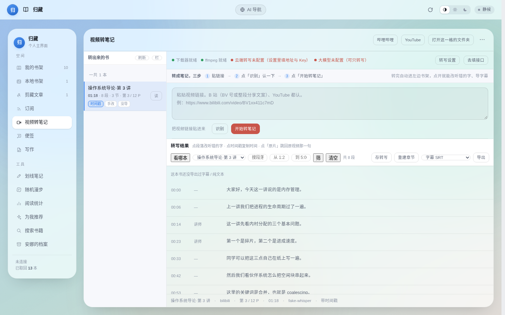

**AI 小结：一个入口，两种模式**

- 读书、剪藏、视频、便签四条来路共用一个「总结一下」，不再各处一个按钮。
- 范围按内容本身来：整本书一次只处理**当前这一章**（整本喂进去既烧钱又答得空），剪藏文章 / 视频转写 / 一条便签这类「本来就是一篇」的，整篇读。
- 两种模式挑一枚芯片：**学习理解**走费曼那一路——先讲透，再给最小执行步骤，最后问一句「你打算怎么用它」，逼你输出一次；**归纳**把水分挤掉，只留能扫完的要点。
- 同一份内容两种模式各存一份，互不覆盖；换一章或改了正文，旧的会自动重算。
- 一键出 SVG 思维导图：骨架由模型给、坐标由后端算，四形态照旧可编辑。没配 AI 时不谎称总结过，只把范围与字数报给你。

**便签（flomo）**

- flomo 导出的 zip 直接拖进来：条数、每张图都收进本机账，之后离线也能看。
- 界面是**两栏的 memos 布局**：左边一栏随手记灵感（输入即存，和 flomo 一样轻），右边一栏按时间线看全部笔记记录。
- **左栏是富文本编辑器**：上面一条工具条管**粗体 / 斜体 / 小标题 / 无序列表 / 有序列表 / 引用 / 行内代码**，敲的时候就是所见即所得，不用自己写 Markdown 记号；存盘时用写作页那把同一把 Markdown 尺（`wrParse` / `wrGet`）把 DOM 转回记号，所以落盘的笔记一直还是 Markdown。
- **复制粘贴都保留 Markdown**：选中一段复制出去，剪贴板里的 `text/plain` 是 Markdown 记号（粘到别处仍能渲染），粘回来时认出记号就渲回富文本；每条卡片上另有一颗「复制」，一下把这整条笔记的 Markdown 原样放上剪贴板。
- 作为普通笔记条目展示，时间精确到分，标签、字数、图数都摆在卡头上；按天分组，一天一根分隔线。
- 标签按层级认：点 `读书` 会把 `读书/神经科学` 一起捞上来；下面那排药丸写着几条，点进去就筛出几条。
- 长条目自动折叠，点开看全文；一条笔记可以整条收成一本书，进书架跟别的内容一样读、一样记。
- Agent 侧多两个工具：`flomo_notes` 按标签 / 关键字 / id 取原文，`flomo_portrait` 读那份「记忆画像」。
- 首次接入时 Agent 会读完你的笔记，生成一份**用户记忆画像**存在本机（`cache/flomo/portrait/`），此后每次任务先读画像再动手——画像只有骨架数字与分类习惯，不含任何一条笔记原文。

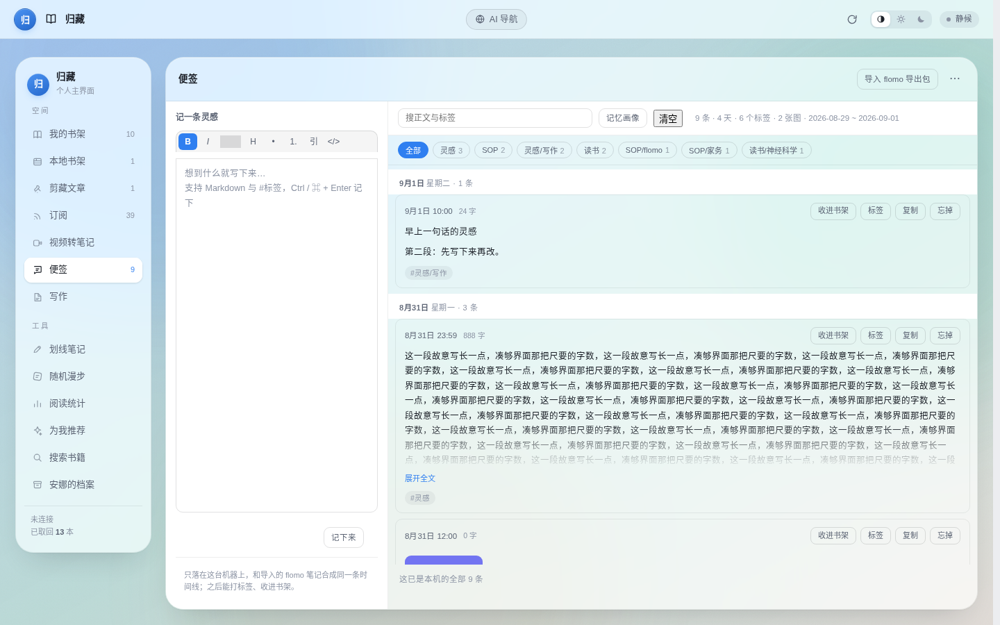

**写作平台**

- 定位是**「AI 只搭手，不代笔」**：字是你自己敲的，卡住了才叫它。一篇稿子就是书库里的一本书（住在第七格 `书库/写作/write_*`），于是目录、标签、封面、清理、MCP 那一整批能力，稿子一行接口都没改就全跟着走。
- **不用手写 Markdown**：正文上面那一排就是全部——正文 / 标题一二三、粗 / 斜 / 下划线 / 删除线、行内代码、字色与底色、清格式、列表 / 编号 / 待办 / 引用、表格（点几乘几就插几乘几）、链接、图片、分隔线；最右留一颗「看 Markdown」，稿子本来存的就是 Markdown，想复制原稿随时拿走。颜色与底色能活着走出导出：预览、图片、PDF、电子书里都在，不是只有屏幕上好看。
- **稿子能成书**：左栏从「一叠散稿」变成**书 → 第一章 / 第二章**——建一本书，把已有的稿子归进来或者当场新起一章，上下挪顺序；书名能改，整本一起导出（还是那四样格式，合稿按册上的顺序拼）；「解散」只是把组取消，一章稿子都不会少。
- **续写**：按你点的那一档接着写——**一句 / 一段 / 三个要点 / 写完这一节**。写多长你说了算，不让模型自己拿主意；素材可以从你的划线、便签里挑，也可以现打一段丢给它。
- **灵感**：卡壳时让它给**三个**方向，只给方向、不给成稿；不满意点刷新就换一批，已经给过的角度它记着，不会翻来覆去说同一句。
- **润色改写**：先选中那一段再动手，语气几档可选；回来的是**按差异切好的一块一块**，你逐块接受或退回——这条路上没有任何一步会直接盖掉你的正文。
- **存盘认版本号，不认时间戳**：界面、Agent、命令行同时改一篇稿子，后写的不会被先写的悄没声地盖掉，对不上就把两边都摆给你看。每存 20 次拍一份快照、最多留 30 份，空转的自动存盘不占位置；回退只回退到真改过的那一版。
- **导出四样：图片 / PDF / 电子书（EPUB）/ Markdown。** 图片有四种排版模板——**黑白简约、商务蓝、青翠、米白书简**；页眉页脚可以带上**工具名（归藏）与日期**，也能带上「字数 · 日期」那一行，三样都能分别关掉。
- 屏幕上预览的那一份，和导出来的那一份，是同一份 HTML：换模板预览立刻跟着变，存下来的就是你看见的。

**个人主界面与两张热力图**

- 左上角那颗头像点开就是个人主界面：**本地上传头像、改名字与简介**（名字 40 字、简介 200 字封顶），原「设置」那一格挪到了这一页最下面。
- 两张热力图各记一本账，互不串味：**学习时长**是「归藏开着在干活的累计时长」，**写作时长**是「人待在写作平台那一格里的时长」。它们和「本机阅读时长」是三笔账，谁也不挪用谁——三件事会同时发生，揉成一个「今日时长」等于什么都没说清。
- 账本写得很克制，为的是让格子诚实：单次最多计 **300 秒**（标签页被冻结、电脑睡过去，不会第二天冒出一根通天柱），单日封顶 **12 小时**，只留最近 **400 天**。
- 每张图上方六个数：今天 / 本周 / 日均 / 连续 / 有记录天数 / 累计。

**AI 导航与内置浏览器**

- 顶端正中那颗「**AI 导航**」点开就是归藏自己的内置浏览器，默认落 `https://ai-bot.cn/`（AI 工具导航），排版收成一屏刚好。
- 内置浏览器用的是软件外壳本就带着的 **Chromium 系网页内核**（Windows 是 Edge WebView2，macOS 是 WKWebView）。外站由本机后端取回来、补一条 `<base>`、再送进 iframe——这样 `X-Frame-Options` / CSP `frame-ancestors` 挡不住它；页面里点链接、提交表单会翻译成给界面的一条消息，由本机取下一页，所以是在归藏里一页页往下走，不需要跳去别的浏览器。
- 取回层只认 `http` / `https`，本机与内网地址一律拒绝（与剪藏同一把尺子）；不写盘、不留 cookie、不建浏览器档案。**要登录或过验证的站点**（例如安娜的档案下载页）仍请走弹出窗口那条路——会话留在浏览器档案里，归藏一行不读。
- 以后凡是「需要在浏览器里打开某个外站」的地方，都优先走这一层内置浏览器。「视频转笔记」顶部那两颗「哔哩哔哩 / YouTube」入口就是照这条走的：先在内置浏览器里逛着挑，再把链接贴回转写框。
- **YouTube 这类纯客户端页面由归藏自己读那坨 JSON**：iframe 的 `sandbox` 故意不给 `allow-same-origin`（不让外站读归藏自己的本地存储），于是站点脚本一碰 `localStorage` 就抛，回来的 HTML 只有一层空壳——正文全在 `var ytInitialData = {…}` 里。归藏自己配对扫出那坨 JSON，按新、旧两代卡片形状认出标题、频道、时长、多久前与缩略图（缩略图只引 YouTube 自己的图床，视频 id 卡死形状），铺成一页静态目录；点链接照旧走同一条 `/api/browse`，每支旁边那颗「**转成笔记**」把链接送回视频那一屏直接开跑。它未登录时的首页与几个 feed 页**连那坨 JSON 里都不放内容**（2026-10-16 实测：首页 950KB 里 `videoId` 出现 0 次，正文只有一句「搜索视频，开启 YouTube 之旅」，真浏览器打开也一样），取回来是成的、铺出来却是空的 —— 用户第二次报的「依旧打不开」就是这一页。所以认不出卡片时归藏会按一份落脚点名册再取一处有货的（搜索结果在前、`/music` 兜底），并在页面上讲清为什么换；带着用户自己敲了搜索词的那一页不换。缺的只有播放器本身，流式媒体这一层从不代理。
**侧边栏与导航**

- 十三个入口：七个空间（我的书架、本地书架、剪藏文章、订阅、视频转笔记、便签、写作）+ 六个工具（划线笔记、随机漫步、阅读统计、为我推荐、搜索书籍、安娜的档案）。这份名册只存在后端一处（`NAV_ITEMS`），界面照着它渲染，页面里不抄一份。
- 侧边栏默认**常驻摊开**；想清静可以在设置里切成**靠左缘滑出**——鼠标往左边缘一靠，它带着一套果冻式的弹出动效滑出来，头像也像一直长在那儿一样跟着浮起，指针移回内容区就自己收回去。
- **点一下才切换**：点哪一格就切到哪一屏；指针划过不会自己跳页（早年试过「悬停即切」，窗口一重排就容易被误触，已改回点击）。
- 入口能**长按拖拽**重排，顺序跨重启留着；不想要的在设置里取消勾选即可（不许全关，至少留一个）。
- 每次重启落回「我的书架」，不记上次停在哪一屏。

**控件质感与交互反馈**

- 全站能点的东西共用同一套**触感**（1.2.1）：按下去缩一点点、松手弹回来；键盘走查才描一圈强调色焦点环，鼠标点不描。
- 按下的一瞬在**落点**散开一圈淡淡的涟漪（`fixed` 定位、不占布局、不被父框裁剪，三百多毫秒后自己移除）；批量渲染出来的书卡按序轻轻抬起入场；「加入书架」这类做成了的动作给一下放大回落。
- 时长与缓动收在几个动效令牌里（`--fx-fast / --fx-dur / --fx-out / --press`），组件只引用，不再各写各的魔法数字；反馈只走 `transform / opacity / box-shadow / filter`，**绝不动宽高边距**，所以悬停不会把版面顶歪。
- 系统设了「减少动态效果」时，涟漪、入场、回弹与按压缩放全部关闭。

**统计、回顾与同步**

- 阅读时长双源记录：微信读书与本机各记一份，再合并成一个统一时长，两份账目分列，看得出合并从哪两段拼出来。
- 随机漫步：从全部划线里抽卡回顾，**本机取的书的读书笔记也一起抽**（顶栏「全部 / 微信 / 取书」三档，1.2.1）。划线可批量转 flomo（原文以「」包裹，附书名与标签）。
- **划线笔记可勾选范围导出 CSV**：右栏每条带一个勾选框，勾好几条点「导出 CSV」，出来的就是 flomo 的导入格式（带 BOM 与 `content,created_at` 表头，时间写 `YYYY-MM-DD HH:MM:SS`）——直接拿去「flomo → 导入」就能把这批划线变成笔记，不用一条条手抄。文件落在你选的导出文件夹里（没选就落在数据目录下的 `downloads/`），重名自动加序号，不覆盖旧的；导出完那颗提示上挂着「打开文件夹」。
- WebDAV / OneDrive 云同步：阅读时长、阅读记录、书籍文件三项可分别勾选，凭据只留本机。

**界面自己盯得住后端的成色**

- 每次进页面都跟本机后端对一次代码指纹。对不上就在页顶出一条横幅，两边版本号各写各的，右边一颗「换新后端」——点一下后台换班，新进程绑回同一个端口，页面自己刷新。
- 换不成时说的是什么就是什么：后端正在跑任务就写「不打断它，等这一趟跑完再换」；那个进程确实比界面旧就给你手动重启的路径；真连不上才说连不上。
- 四个入口（两个启动脚本、MCP 适配器、macOS 壳）认的是同一把尺子，不会出现「脚本以为壳起了、壳以为脚本起了」这种两边干等的局面。

**给 AI Agent 用**

- 零依赖的 MCP 适配器，61 个工具（取书、批量取书、视频转笔记都是长任务、不阻塞调用；服务没起时适配器自己把它拉起来）。
- 仓库内 [`skills/`](skills/) 可直接安装；界面里「一键建立 MCP」把接入提示词复制给你的 Agent。

## 它在细节上在意什么

这个工具是围绕几件很具体的事在做取舍，写在这里，方便你判断它合不合你的用法。

**东西是你的，就得放在你能看见的地方。** 取回的书、导入的书、笔记、脑图、画板，统一放在 `~/Documents/归藏/`；笔记跟着书走，跟着目录一起搬走就行。应用包本身始终只读、可以随便挪；运行时要写的（虚拟环境、缓存、登录态）都在 `~/Library/Application Support/归藏/`。**设置里的「清除本地数据」不会碰你的书**——它清的是登录态、索引、封面、下载中间件这些它自己攒的东西。

**不替你连任何第三方。** 服务只绑 `127.0.0.1`，不经任何中转。往外的连接只有你自己点名的那几处：划句翻译 / 问助手会把你选中的那一段发给你填的 AI 接口，视频转笔记在选了云端转写时把音频发给你填的转写接口，「安娜的档案」那一栏只连安娜的档案自己的站点（而且是**你自己在那个窗口里浏览**，归藏不代抓、不代填、不读它的 cookie）。归藏不预置任何地址、不代传，没填就不发——所以没配 AI 时它只存转写全文，没开那个窗口时这一栏就是「窗口没开」。

**密钥只回显末 4 位。** Key 存在本机 `cache/config.json`（权限 600），界面上永远只看到尾巴四位；所有按目录 id 取路径的接口都过一遍正则 + `realpath`，图片写盘前校验魔数。

**大东西不拦门。** Chromium 那 368 MB 是取书的硬前置，所以放在配置页等；ffmpeg 那几十 MB 也一样在安装那一步到位。转写自 1.0.8 起只走云端，本机不再下 GB 级权重——省下来的空间与时间都是你的。组件下载失败也不堵住取书：它只是视频那条线暂时不能用，进门后在设置里补一下就行。

**删东西都给一次反悔。** 划掉一条笔记，右下角那条提示上挂一颗「撤销」，点一下就原样放回去；订阅的清理先跑一遍「会删多少条」给你看，点了才真动手。比起弹个确认框拦在前面问一遍，这样更省事。

**抓回来的东西是数据，不是命令。** 订阅正文、剪藏正文一律按数据渲染（Markdown 渲染器关掉 HTML 直通），标签和正文里写什么都不会被执行。

**挡实体炸弹那道闸得扫完整份。** 导入 EPUB 时那份 OPF 是从外面带进来的（安娜的档案领回来的、用户自己找的包），而 XML 解析器对**内部**实体是照着声明展开的：几百字节的「十亿笑」能解出几十万字符，再深几层就是几个 G。所以解析前要先问一句「这份文档里有没有 `DOCTYPE` / `ENTITY` 声明」——这一句原来只看开头 4KB，而且大小写敏感：在声明前面垫一段超长注释就能把它顶出窗口，闸门等于不存在。现在扫全篇；OPF 正文里的尖括号本来就得写成 `&lt;`，正常包一个声明都不会有，收严不会误伤。导入 OPML 那一路早就是「全篇扫、不分大小写」，两条从此一样长。

**外站那一页宁可自己铺，也不放宽权限。** 内置浏览器给 iframe 的 `sandbox` 故意不给 `allow-same-origin`——那是防着外站读归藏自己的本地存储。代价是 YouTube 这类纯客户端页面在这种不透明源里一碰存储就抛：取回其实成功了，回来的 HTML 却只有一层空壳，正文全在 `var ytInitialData = {…}` 那坨 JSON 里。为了它放宽 `sandbox` 等于拿用户的界面换一页视频，所以改成自己把那坨 JSON 读了——卡片、频道、时长、缩略图用归藏的话铺成静态目录，链接照旧走同一条 `/api/browse`，「转成笔记」也挂在同一张卡上。缺的只有播放器本身：流式媒体这一层从来也不代理。
**外站那一页宁可自己铺，也不放宽权限。** 内置浏览器给 iframe 的 `sandbox` 故意不给 `allow-same-origin`——那是防着外站读归藏自己的本地存储。代价是 YouTube 这类纯客户端页面在这种不透明源里一碰存储就抛：取回其实成功了，回来的 HTML 却只有一层空壳，正文全在 `var ytInitialData = {…}` 那坨 JSON 里。为了它放宽 `sandbox` 等于拿用户的界面换一页视频，所以改成自己把那坨 JSON 读了——卡片、频道、时长、缩略图用归藏的话铺成静态目录，链接照旧走同一条 `/api/browse`，「转成笔记」也挂在同一张卡上。它未登录时的首页 / feed 更进一层：连那坨 JSON 里都不铺内容，取回来是一页空的 —— 所以认不出卡片时归藏会再换一处有货的落脚点，不把一页空的当结果。缺的只有播放器本身：流式媒体这一层从来也不代理。

**两处真相会越用越歪。** 导图的坐标一律在后端算完再交给前端画——命令行、MCP 适配器和自测都没有浏览器，却都要能出图；前端要是再排一遍，存回去的坐标和屏幕上看见的就会一天天对不上。

**一个坏值不该带走一整屏。** 账本、口令条、卡包、登录态这些文件会被手改、被云同步落回旧版、被站点回一句不像样的 JSON。Python 的 `json` 认 `Infinity` 和 `NaN`，也吞得下 10 的 400 次方，读写两头一路绿灯；浏览器却按 JSON 规范整份拒收——于是代价不是「那一栏显示不对」，而是每 2.6 秒一次的轮询什么都读不出来。落单的半个代理码点同理：它进得了 JSON，却编不成 UTF-8。这一类口子已经逐条收口：越界数字走整除并用 `math.isfinite` 拦，坏字符统一用同一把尺子洗，形状不对的（该是对象却回了数组、字符串、`null`）退回默认值而不是抛异常——问模型那一路同理，`choices` 写成数组、`message` 写成裸字符串、流式片段里回一句 `data: []`，都当认不出，退成「认不出来」那句人话而不是带出一串 Python 报错。同一份读数写成 `10000000` 还是写成带引号的 `"10000000"`，也是同一句话：超长的那一边会撞上 Python 给「十进制串转整数」设的位数上限，旧写法只有「退回下限」一条路，于是同一句话读成两个数——现在越线的按上限收口，与数字那一支落在同一个终点，而 `"3.5"`、`"1e5"` 这类写法照旧算认不出（半章不是一章，宽容只会把一个坏值折成一个看起来正常的数）。每一条都配了一条不联网、不开浏览器的离线门禁，并且当场证明「旧写法确实会炸」，免得门禁只是空转。记事本「另存为」和某些云盘回写多塞的那三个字节 BOM 也算坏值：读口一律按 `utf-8-sig` 认，不然 `json` 当场解不动，被那句「读坏了给空表」宽宽收成空账——写作屏那本册账以前就漏了这一档，而紧接着任何一次建书、改名、加章都会把这份空账写回盘，用户搭好的书目就此静默消失（稿子都还在，组没了）。

**点了没反应也算一种报错。** 后端每条路由各自只有局部的 try，落盘那一步（账本位置被占成目录、盘写满、目录只读）没被圈住时，异常会一路穿出请求处理；`http.server` 不替谁回 500，它只把连接一关——界面 `await` 收到的是「连接断了」，onclick 里没 catch，用户看到的就是按钮按下去什么都没有。现在兜底长在每个请求外面那一层：还没回过话的补一句「这个操作没做成」，并往日志里留下是哪条路由、什么异常；已经吐了半截的流式响应不去追尾，路由自己接住过的照旧按它那句话回。

**封面只取屏幕上看得见的那些。** 一个书架一批是 60 本，一次把整批的封面地址都塞进 `` 就是一进书架甩出 60 个请求，而一屏放得下十几张。现在卡片先进文档、滚到眼前才点亮；叠卡那一面只点亮扇形里那七张，翻一下书补点一张。

**替用户取东西之前先认一眼地址。** 书库里那些插图地址是从抓回来的网页里扒的，用户还能手工编辑，什么都可能是。默认那把取回的工具认得 `file:`：一条 `file:///Users/…/.ssh/id_rsa` 会被原样读回来写进 `images/`，之后跟着书库一起同步出去——而「防止访问本机」那道闸只管跳转目标，管不了「一开始喂进来的就是本机文件」。现在下载插图前要先过一遍与剪藏、平台解析、内置浏览器共用的一份 scheme 名单：只认 http/https，解不出来的（半截 IPv6）也算不合法，一次请求都不发。订阅那一条线是同一件事里更隐蔽的一半：要取回的地址有三个来源——用户当场粘进来的、页面里 `<link rel=alternate>` 与 `Link:` 头写的、`feed.json` 里存着能被手改或云同步落半截的那份，旧写法只在第一处核过 scheme，后两处直接喂给取回口。别人页面里写一条 `href="file:///Users/…/.ssh/id_rsa"`，点「发现订阅」就会把本机文件读回来当订阅解析，认得出来就整篇进书架。现在这道闸收在唯一那条取回口上（真发请求之前再核一次），三处一起盖住，以后新增取回路径也漏不掉；「发现」列出来的候选同时按它筛过，坏地址连摆都给界面都不摆。顺带把「这个地址解不出来」那几种情形改成说人话，不再把解释器那句 `Invalid IPv6 URL` 原文甩给用户。

**挡本机与内网那道闸，量的是真要连过去的那个主机名。** 归藏有一条共用的尺子（`clip_article.host_blocked`）：剪藏取页、内置浏览器、平台解析、首图与封面兜底都从它过，回环、私网、`169.254.169.254`（云元数据那一格）一律不放。旧写法只认字面量，而 `urlparse().hostname` 不做百分号解码、`urllib` 发请求前却会把主机名解一次码——护栏看到的是 `%31%32%37.0.0.1`，socket 连的是 `127.0.0.1`。于是外站页面里一张编码过的首图，或随手粘进来的一条编码链接，就能让归藏替对方去敲本机、内网、元数据地址，回包还会被收进剪藏或封面文件。现在这把尺子按 `urllib` 那一步先解一次码再判，并且只解一次（`%2531…` 解出来仍是 `%31…`，DNS 认不出，不构成第二条通路）；解码放在方括号剥离之前，`%5B::1%5D` 也照样认得是回环。公网域名一个都没放宽，编码过的公网域名照旧放行。

**写盘只留完整的那一份。** 后端是多线程的，同一张封面会被两处同时写：一进书架并发取几十张，后台补封面那条线也在动同一批书，详情页大图还会再敲一次。固定临时名的老写法会让后到的那次改名扑空——下载明明成功了，封面没落上，旁边还留一个没人认领的 `.tmp`；直接写目标文件更糟，中途进程被杀就留半张图，而读口只按文件大小认「有封面」，那张破图会被一直当成真封面用下去、再也不重取。现在封面跟 JSON 走同一条口径：临时名带进程号和随机串互不打架，写完原子顶替，失败把临时件收干净再抛，旧档始终是完整的那一份。AI 小结那一格是同一个毛病的另一种后果：`open(path, "w")` 一进去就把旧稿截断了，恰好在写完之前被强杀（关窗口、断电、换一本书重开），盘上只剩半截 Markdown，而读口认它就是上次那一份——打开看见一段断在句中、再也长不回去的小结，还省不掉再问模型一次。现在也走「同目录写临时件、改名顶替」：改名在同一文件系统上是原子的，要么旧稿完整、要么新稿完整；没走到改名那一步就把临时件收掉，连中止信号那条退出路径也不留（它不继承 `Exception`，只兜 `except Exception` 会在半路上漏件）。临时名同样补上进程号与随机串——存这份小结的入口有两个（点一下当场等回包的那条，和丢进后台任务的那条），服务又是多线程的，同一本书同一个范围被两处同时问出来时，固定的 `.tmp` 会让先改名的那个把件搬走，后一个改名扑空：保存其实成了，回包却是「没存上」，用户再点一次还是同一场。便签那本账早就是「临时件 + 改名」，可临时名只带进程号——同进程里的两个请求线程（手记、打标签、忘一条、清空、导入全走这一个写口）落到的是同一个件：后来者把前一个人写了一半的临时件截断，两边各按自己的偏移往下写，改名顶成正式账本的是两份内容交织的那一份，读口解不动就整份退回空账，界面上是「便签全没了」；而先收尾的那个把件整个搬走，后一个轮到自己那一句时临时件已经不在，带着异常出去，用户看到的还是「点了没反应」。现在临时名跟封面同一档（进程号 + 一小串随机），失败先把残件收干净再抛。

**取书取到一半被掐断，那半截章最会骗人。** 取书是能中途叫停的长任务：停止键先请引擎把手上正在攒的那一章落盘再退，可它一分钟内没退就会被强制结束，关窗口、断电、活动监视器里杀进程也一样。而「这一章写过没有」是靠扫章节目录认的：文件名 `0007.md`、第一行 `# 第七章 章名` 都在，续传就把这一章算成已经写出来了。老写法是 `open(那一章, "w")` 直接写目标文件——一进去旧内容就被截断，恰好在写完之前被强制掐掉，盘上留下的就是那份「章名完好、正文缺后半截」的假成品：不报错、不丢文件，只是这一章少了一半内容，而且再也没有人会去补它。整本合并稿是同一趟的最后一步，掐在那里，`<书名>.md` 就是个半本，可它一直躺在输出目录里像个成品。现在正文类落盘与账本走同一个口子：先把整份拼好写进旁边的临时件，写完再一次性改名顶替，被掐掉的那一份压根不出现（临时件不以 `.md` 结尾，扫目录认不到它），旧那一版一个字没动，重跑自然会补上这一章。画板是这一族里最重的那几次写（一块画布上限六兆，还要先把旧档挪成上一版再顶替），而它直接挂在多线程的请求上，同一块板被两处同时写完全够得着——两处共用一个固定临时名时，先改名的把件搬走，后一个当场扑空，界面看到的是「没存进去」，画其实已经落了一半，旁边还留一个没人认领的临时件。现在画板那两条写口也换成「进程号 + 随机串」，删板时按同一个形状把这块板留下的残件一并收掉（旧写法只认一个固定名，随机名残件是看不见也删不掉的吃盘洞）。

**自己写自己的账，两处同时写就不能共用一个临时件。** 读书笔记（`notes.json`）、手画的导图（`mindmap.json`）、视频转写稿（`transcript.json`）这三格，以前都往一个固定名的临时件里写。后端是多线程的，而这三格各自都有「两个写手」的形状：笔记是保存与「收成书」导出，导图是界面那次保存与「让 AI 画一张」那次（它要等模型回包，最长 180 秒，等的这段时间里界面那次完全可能把同一份图存下去），视频那一格还要再多一层——保存与重建跑在服务进程的线程里，下载转写却是后端另起的一个进程，两边写的是同一份稿子。固定名的后果有两种，都不体面：先收尾的那个把共用的临时件整个搬走，后一个轮到自己那句改名时件已经不在，当场抛错，界面「存不下」，可前一笔其实已经落盘；更坏的一种是两个人同时在写那一个件，后来者一打开就把它截断，两边各按自己的偏移往下写，改名顶成正式账本的是一份内容交织的稿子，读口解不动就整份退回空账——界面看着是「这本书的划线全没了」，而那本账刚刚是两个请求各自按规矩写的。现在这三格跟封面、便签、画板同一档：临时件一次一个名字（进程号 + 一小串随机），写完一次性原子顶替，写崩了先把残件收干净再抛。笔记那一格还多一手：新稿没能顶上去、而旧档已经被挪去留底时，把上一版搬回来，不会因为一次落盘失败就让整本账不见。手画导图那一格原先只有「先挪成上一版」这一半、没有搬回来那一半——改名那一步失败时正式那份已经被挪走、新稿又没顶上去，打开就是一张空图，现在也收进同一手。便签那条线又补了两处：两条笔记收进**同一本书**时写的是同一份 `meta.json`，画像缺档时两次读会各算一份落盘 —— 固定临时名在这两种情形里都会让后收尾的那次当场扑空，症状是**书已经进了书架、回包却喊「收进书架失败」**。订阅（RSS）那一格同属这一族，三处落盘够不够得着并发是三档，逐档数过：导 OPML 那一处**真够得着**——默认落同一个 `<数据目录>/订阅.opml`，而服务是多线程的，连点两次「导出」就是两只手同时往同一个临时件名上落，先收尾那个把件搬走、后一个改名当场扑空。账本 `feed.json` 那一处**同进程够不着**——那把 `RLock` 罩住的不止刷新，全仓 19 处保存调用都在锁内（标已读、收藏、打标签、删订阅、建分组、改设置都在内），「读整份 → 改一笔 → 写整份」本来就是串着的；够得着的是跨进程那一档：在终端里跑 `python3 feed.py --refresh` 时，界面与它各锁各的进程、写的是同一个文件。收进书架那份 `meta.json` 每次开的是新书目录、够不着别人，留着固定名只会让这一族多一把尺子、残件多一种认不出的形状。导入与剪藏那一格是这一族的最后几处：一份文件收进书库只有一个入口（导入本地书、剪藏、订阅收成书、视频重建都从它过），一次要写 `meta.json` / 目录 / 进度三份账，剪藏紧接着又把 `meta.json` 读回来补几个字段再写一遍——两处用的都是固定名，而且**连一句失败清理都没有**，写到一半断掉就在书目录里留下一个界面上删不掉的半截件。同一趟里一前一后、够不着并发，收它是为了不留垃圾、也为了这一族只留一种名字形状。取书自己那两个写口（账本与章节合并稿）和运行时那份端口回执是同一档处理。**这一族到此收干净：全仓只剩登录态那一处还写固定名**，它只有一只手（登录是另起的子进程，全局单任务闸同时只有一趟；界面侧只读，清除数据只删），够不着并发，逐格记在《交接说明》§2。

**稿子被人拿别的编辑器改过，就得按「改坏了也得能读」来读。** 写作那一格的正文与每一版快照、视频那一格的转写稿与那份 AI 配置，都是你会直接编辑、或者被云同步与别的编辑器写回来的文件。两件事会在那里发生，一种比一种安静。一种是**编码签名**：Windows 记事本「另存为 UTF-8」会在开头多塞三个字节，`json` 解不动它，而那句「读坏了就当没有」的宽 `except` 把整份吞成空档 —— 转写悄悄退回没有时间的旧纯文本（时间戳与你改过的字都没了）、按段 id 留着的说话人与置信度在下一次保存时静默丢掉、AI 明明填着却一直说「没配」。读口一律按 `utf-8-sig` 认（写口不主动种 BOM，宽容只放在读的那一侧）——订阅、画板、便签、笔记、导图那几处早就是这么读的，视频那几处补得晚，取书自己那四本账（目录、进度、钉不住的那一份、原始页）是这一族最后收的。**这一族还剩两处**：剪藏把刚建好的 `meta.json` 读回来补几个字段，和扫插图任务时把 `raw/*.json` 那一本记录读一遍——两处都只坏在读的这一侧，够不着「当场报错」，够得着「悄悄少东西」（前者以空账为底重写那份元信息，后者那张图不重下、界面看不出为什么少图），逐处记在《交接说明》§2。另一种是**坏字节**：一稿被另存成 GBK，或一次写到一半断了电，严格 UTF-8 读法抛的是 `UnicodeDecodeError` —— 它不是 `OSError`，而写作那一格两个读口原先只兜 `OSError`。代价不是「那一段显示不对」，而是整篇打不开、存盘被顶回（看着像「保存没反应」）、连快照一列都列不出来。现在它接的是章节正文早就在用的那把容错尺：认不出的字节只丢它自己、换成一个替代符，正文其余照旧，读不到才当真没有。同一格里落盘那三处（正文 / 那份 `meta.json` / 册账）也一并换成「临时件一次一个名字」，两个进程同时存同一篇，落地的必然是其中一份完整的稿，而不会是两个字节流交织起来的那一团。

**被掐断留下的那半截合并稿，删书时得跟着书走。** 取书那一趟的最后一步是「先把整份拼进内存、写成旁边一个带进程号与随机串的临时件，再一次改名成 `<书名>.md`」，恰好在改名之前被强制结束（停止键、关窗口、断电），盘上就只剩那个半截临时件。它不以 `.md` 结尾，清残稿那两本点名名单都指不到书库根与模块文件夹那一层，而「删掉这本书」原先只收 `<书名>.md` 那份可再生副本 —— 于是它在界面上看不见也点不掉，只能一直占着盘。现在同一处一并收走（清残稿、删一本、批量删三条路都从那儿过）：合并稿的临时件有过两族名字，老那版是一个固定名、现这版一趟一个名字，所以收它按形状数——以**这本自己的** `<书名>.md.` 开头、以 `.tmp` 结尾。收窄到这本的前缀是故意的，书库根那一层住着所有书，别家的半截稿一个都不能碰。其余护栏照旧：同名的目录不碰、书名里带 `../` 的那种拼不出库外的路径，你自己写的笔记一个字不动。

**随机名的半截临时件，也得有一刀能收干净。** 临时名换成「进程号 + 一小串随机」之后，写崩那种情况由各个写口自己收掉（`except BaseException`，连中止信号那条退出路径也算），可断电、`SIGKILL`、活动监视器里强杀这一档只有磁盘看得见：那份半截件不进任何读口，也点不进老那份只认六个固定名的清理名单 —— 界面上看不见、删不掉，一块画板最多六兆、一本导图几兆，攒着就是吃盘洞。现在清残稿那一刀顺着这本书的目录走一遍，以 `.tmp` 或以 `.part` 收尾的都收走，画板 / 导图 / 视频 / AI 小结那几本子目录一起扫。两个尾巴是同一档：书目录里没有正经产物以它们结尾，而云同步取回的文件与插图下载都先落这两个后缀再一次改名。**没有再按「名字里带进程号」收窄**：那一档会漏掉改名之前的固定名半截件（`mindmap.json.tmp` 那一类），而它们和随机名残件是同一类垃圾；书目录是引擎自己的产物区，以 `.tmp` 收尾的普通文件按定义就是没写完的临时件。护栏落在「不是普通文件的不碰」：符号链接（哪怕名字以 `.tmp` 收尾）与同名目录都不删，扫描也不会跟着链接走出这本书，你自己的划线（`notes.json`）和这本书的身份（`meta.json`）一概不动。书目录那一头由清残稿收；`cache/` 与数据根那一头归「清除本地数据」——它原先按一张精确路径的白名单删，而残件的名字带进程号与随机串（现版只剩登录态那一处还写固定的 `<账本>.tmp`，改名之前那几处留下的残件也长得这样），一个都认不到，于是点完「清除」界面回「已释放 …」，半截 `config.json` 还躺在盘上、里面就是你的接口 Key（换机、把机器送人之前最常点的那一下，本该连它一起带走）。现在它按同一张白名单逐名去收这些 `.tmp` 兄弟：试算里如实列出、真清时一并删掉，名字前后锚死、只认普通文件，同名目录与符号链接一概不碰，不认识的 `.tmp` 也不动。`.part` 那一族在这一层还指不到：云同步往 `cache/` 里取回账本时先落的也是半截件，尾巴是 `.part`，断在改名之前就一直躺着——书目录里那一半归清残稿这一刀管，`cache/` 与数据根这一半还没人认，记在《交接说明》§2。

**含密钥的字段只回末四位。** 微信读书的 Key、云端转写的接口 Key、云同步的密码，界面上回显的都只是「有没有」和最后四位——明文既不往界面送，也不进日志。

**报错那句不能编。** 界面每 2.6 秒跟后端对一次话，对不上的种类是有区别的：连不上、后端比界面旧、后端回了一句看不懂的话。以前这三样揉成一条「本机服务没在跑」，于是明明服务跑着、只是旧，人被引去查一件本来没事的事。现在这四条各说各的话，页顶横幅还会把两边版本号打出来，点一下就能换。存转写也一样：回执说「存好了 8 段」的那一帧，按钮上那颗「待存 3 处」的红点必须同时退掉，不能等下一次刷新才想起来。

**窄的地方不牺牲最要紧的那两颗钮。** 划词小条在窄窗里会折行、宽度封顶，但「写想法」「写条目」一定留着——被挤出去过的正是这两个。

**换屏落在开头，一件事点一次。** 每次切到另一屏，窗口都回到最上面，而不是停在上一屏滚到的那一半——那看着像「上下闪一下」，其实是要人再滚回去。打开一本书时那行「续读」照旧回落到上次停下的位置，两件事各管各的，谁也不拽谁。视频转笔记也砍成一根手指：链接贴进来（或点手指从剪贴板取），按下去就是「认出链接 + 开跑」一条道走到底，进度收在手指外圈那道环上，中间不再要你点第二次「转笔记」。

**长链接不该被压扁。** 订阅和视频那两栏的输入框一行起步、跟着内容自己长，长到上限再在框里滚；几十个字的书城与视频地址不再挤成两团，占位文案也保持一行。

**画布上的笔不该被窗口挤成一团。** 画板从「一张 1040px 的居中小卡、一块跟着窗口改尺寸的画布」改成铺满视口的两栏工作台加一张固定 3200×2200 的大纸。改法不是把数字调大一点，而是换掉那条路：以前窗口一变画布跟着变（`setDimensions`），画的笔按比例挤；现在纸的逻辑尺寸不再动，看哪儿全靠 fabric 的 `viewportTransform` 平移 —— 指针拖动、触控板双指、滚轮三条路都在同一个裁决点上（选工具下拖空白才挪，画笔手里的拖动是画不是挪，⌘ 滚轮才是缩放）。挪的是视口，纸上的对象一个坐标都不动。落盘时视口先复位：存的是「这块板」，不是「我此刻盯着哪儿」，所以重开一块板回到它的左上角，而不是把你扔回上次挪到的角落。

**一屏不该是二十颗钮摊一行。** 写作台的工具条曾经从左排到右、排不下就折行，看的人得先把「粗 / 斜 / 下 / 删 / 码 / 字色」这些词的形状认一遍才知道哪颗是干什么的。现在按一句话一刀分三摊：**这段是什么**（段落样式是单选，收成一颗钮 + 一张弹层，而不是摊开四颗标题钮）、**这几个字什么样**（行内格式七颗，全是图形，摊在最顺手的位置）、**往这儿放点什么**（低频的表格 / 链接 / 图片 / 分隔 / 清格式收进一颗「+」，要用了才展开）。三摊用间距分组、不用竖线 —— 一排小方块加竖线还是像旧系统。画板那一排同理：笔、荧光笔、直线、箭头、方框、圆、文字、橡皮、选择，撤销 / 重做 / 清空，五种纸面，全是图形。

**旧系统长什么样，是有具体样子的。** 视频转写的段落曾经是四列网格 + 每行一道横线，一屏看过去全是格子；现在是一张张轻卡片（圆角、左右留白、悬停才浮起），段落与段落靠间距分开，时间戳与说话人合成卡片顶部一行元信息（它们回答的是同一个问题：谁、在什么时候说），工具条按「挑书 / 筛 / 动作」分三簇。订阅左栏的「看哪些」曾经和右边四颗钮挤在同一个 `flex-wrap` 里 —— 26px 的钮撑起栏高，19px 的标题只能垂直居中，和按钮里的字不在一条基线上，这就是「排版有偏移」的根因；现在栏头分左右两区，标题独占一区并带上那颗计数（0 个源 · 0 条），计数 `nowrap` 且 `flex:none`，它一折整行高度就飘。

**叠卡翻书，页码留在自己那一栏。** 舞台高度、底部留白、卡宽三档是一套自洽的数（投影算下来最矮的卡与最宽的卡两头都验），导航那一排收在所有层之上——左右切页时压住页码的那一下，是卡比留白高了出来。封面一律 `aspect-ratio:2/3`，卡片入场才量得准。

**装过的能卸干净。** 设置 → 维护里有「卸载组件」与「清除本地数据」两步：前者卸 ffmpeg、Chromium（几百 MB），后者清登录态与各种索引；软件本体你自己拖进废纸篓就行。

**这些不是说说而已。** 仓库里那套自测是真开一个 Chromium 点一遍的：

```bash
bash tests/run_all.sh          # 静态检查 + 真机走查
bash tests/run_all.sh --fast   # 只跑静态那几项，秒级
```

每一次改动都在这个门禁里过一遍才提交——包括上面这些「细节」：截图里的排版、笔记能不能点、删掉能不能撤、服务没起时适配器能不能自己把它拉起来。

## 环境要求

- **Python 3.9+**：后端就跑在它上面。装成 macOS 程序也要求机器上有一个（3.9 即可）；从源码跑建议 3.10+。
- **Node**（可选）：只有 MCP 适配器要用，`node -v` 能输出版本号就行。其余功能都不需要它。
- **微信读书账号（可选）**：只有取微信读书的书、看划线笔记与统计时才需要，且要对目标书有阅读权限（无限卡或已购买）。剪藏、RSS 订阅、视频转笔记这三条不依赖它。
- **走「视频转笔记」才需要的只有 ffmpeg**：它在安装那一步自动到位，不必你预先准备。转写本身用云端接口，本机不装引擎也不下模型（想腾空间就到设置 → 维护里点「卸载组件」，随时能再补回来）。

## 安装

### 装（macOS，三步）

**1 · 下载**　[归藏-1.0.9.dmg](安装包/归藏-1.0.9.dmg)　（约 2 MB · macOS 13+ · Intel 与 Apple 芯片）

> 当前源码版本 **1.2.2**；安装包目录里现成的仍是 **1.0.9**（这一轮没打新包）。要打 1.2.2 的 dmg，在 Mac 上执行 `bash shell/build_macos.sh && bash shell/make_dmg.sh`。下载链接继续指向 `安装包/归藏-1.0.9.dmg`（真实存在）。

**2 · 拖进「应用程序」，双击打开**

若弹出 **「归藏」已损坏，无法打开**：这是 macOS 对未签名应用的默认拦截，不是文件坏了。粘这一行就好（装在别处请改路径；提示 `Operation not permitted` 就在前面加 `sudo`）：

```bash
xattr -dr com.apple.quarantine /Applications/归藏.app
```

也可以在 **系统设置 → 隐私与安全性 → 安全性** 里找到被拦的那条，点「仍要打开」。

**3 · 点一下「我思故我在」**

剩下交给它：装依赖、下取书用的 Chromium（约 370 MB）、备好 ffmpeg，然后弹出浏览器让你扫码。**装完直接进界面**；之后每次打开都是直接进。

> 需要机器上已有 Python 3.9+：[python.org/downloads](https://www.python.org/downloads/) 装一个，装完不用重启。包里另附《首次打开必读.txt》，细节与替代做法见 [部署说明.md](docs/部署说明.md)。

### 装（Windows，两步）

**1 · 下载**　[归藏-Windows-1.0.9.zip](安装包/归藏-Windows-1.0.9.zip)　（约 0.9 MB · 解压即用 · Windows 10+）

> 当前源码版本 **1.2.2**；安装包目录里现成的仍是 **1.0.9**（这一轮没打新包）。要出新版 Windows 包，同样在 Mac 上重新打包。下载链接继续指向 `安装包/归藏-Windows-1.0.9.zip`（真实存在）。

**2 · 解压后双击「安装归藏.bat」**

它把程序复制到 `%USERPROFILE%\归藏`，再在桌面放一个「归藏」快捷方式。第一次打开会建虚拟环境、装依赖、下取书用的 Chromium（约 370 MB）—— 那个黑窗口别关，它就是后端，界面会自动开出来。

不想装也行：双击 `启动归藏.bat` 就地跑，程序和数据都留在解压出来的文件夹里。首次运行 Windows 会拦一下（**更多信息 → 仍要运行**），因为这份包没有代码签名证书。

> 需要机器上已有 Python 3.10+：[python.org/downloads](https://www.python.org/downloads/) 装一个，安装第一步勾上 *Add python.exe to PATH*。包内另附一页《首次打开必读.txt》。

> **如实说明**：这个包是在 macOS 上打的，装与跑**没有在 Windows 机器上实测过**。安装脚本、启动脚本、跨平台那几处都按 Windows 的规矩写，仓里也有对着平台标志跑的单元测试，但没有从头到尾跑过一遍。

### 从源码跑

```bash
# macOS / Linux
git clone https://github.com/KEQingFeng/weread-guizang.git
cd weread-guizang
python3 -m venv .venv
.venv/bin/pip install -r requirements.txt
.venv/bin/python -m playwright install chromium     # 约 368 MB
.venv/bin/python ui_server.py --port 8770           # 打开 http://127.0.0.1:8770

# Windows（把上面最后两条换成）
.venv\Scripts\python.exe -m playwright install chromium
.venv\Scripts\python.exe ui_server.py --port 8770
```

也可双击 `启动归藏.command`（Windows 上是 `启动归藏.bat`）：自动识别目录、缺虚拟环境就创建并装依赖，服务已在跑就直接开界面。

想装成可双击的 macOS 程序、或打成可分发的 dmg：

```bash
./shell/build_macos.sh     # 产出 dist/归藏.app
./shell/make_dmg.sh        # 产出桌面上的 归藏-<版本>.dmg
```

外壳是 Swift + WKWebView 的原生应用，界面仍是 `ui.html`；构建只要 CommandLineTools，不需要完整 Xcode。

### 首次使用

1. 齿轮 → **连接账号**：在弹出来的浏览器窗口里用微信扫码。登录态持久化在 `cache/browser_profile/`，之后自动复用。
2. 填 **接口 Key**：微信读书网页版「设置 → 开放 API」里复制形如 `wrk-…` 的 Key。存本机 `cache/config.json`（权限 600），界面只回显末 4 位。书架、笔记、统计、推荐、书城搜索、书籍详情都靠它；不填也能用（只列出本地已导出的书）。
3. 想用**划句翻译 / 单击查词 / 问小助手**（这三样都在阅读器里），在「小 Agent」一栏填一个兼容 OpenAI 的接口（地址写到 `/v1` 为止）、Key 与模型名。
4. 想用**视频转笔记**：B 站 / YouTube 直接贴链接就行。转写走云端 —— 在设置 → **视频转写**里填一个兼容 OpenAI 的语音转写地址与 Key；AI 归纳与上面第 3 步那个小 Agent 接口共用，没填就只存转写全文。
5. 想把划线**转进 flomo**：一种是在设置里填 flomo 的 API（形如 `https://flomoapp.com/iwh/xxxx/`），需要 flomo PRO；另一种更省事 —— 在「划线笔记」里勾选要的那几条，点「导出 CSV」，拿到的就是 flomo 的导入格式，直接在 flomo 里点导入即可。
6. 想从**安娜的档案**下载书：点左侧最下面那一栏，在搜索框里写书名点搜索（或直接回车）——归藏会自己起一个浏览器，把那一页的搜索结果领到你面前，翻页、登录、点下载都在那个窗口里做。下完的文件自动收进「本地书架」。

## 命令行

以下命令可在不启动界面的情况下使用。

```bash
# macOS / Linux
.venv/bin/python export_precise.py <书籍链接或ID>          # 链接会自动提取 ID
.venv/bin/python export_precise.py <ID> --headed          # 显示翻页过程
EXPORT_DEBUG=1 .venv/bin/python export_precise.py <ID>    # 卡住时每 60 秒输出 Python 栈

# Windows
.venv\Scripts\python.exe export_precise.py <书籍链接或ID>
.venv\Scripts\python.exe export_precise.py <ID> --headed
set EXPORT_DEBUG=1 && .venv\Scripts\python.exe export_precise.py <ID>
```

登录与加书架也可单独运行：`login.py`（登录与登录态检测）、`shelf_add.py <书城 id>`。

剪藏、订阅、视频这几条也各有可以直接跑的命令，用于排查而不必开界面（macOS / Linux 用 `.venv/bin/python`，Windows 换成 `.venv\Scripts\python.exe`）：

```bash
.venv/bin/python clip_article.py <文章链接>          # 看这一篇能解析出什么（公众号 / 知乎 / 小红书 / X 自动选路）
.venv/bin/python web_parse.py <链接>                 # 看这条链接被归到哪个站，以及正文前 1200 字
.venv/bin/python feed.py <站点或订阅地址>             # 从任意网址里找出订阅源
.venv/bin/python feed.py --list                     # 现有订阅与各条目的抓取状态
.venv/bin/python feed.py --refresh                  # 刷新全部订阅
.venv/bin/python video_note.py <视频链接> [输出目录]   # 打印视频信息，再整条跑一遍转笔记
.venv/bin/python video_note.py --task <链接>         # 界面用的那条路：选项走 GUIZANG_VIDEO_OPTS、结果打 ##GUIZANG## 一行
.venv/bin/python ffmpeg_tool.py --status            # 看 ffmpeg 备好没有
.venv/bin/python ffmpeg_tool.py --ensure            # 下一份静态 ffmpeg 放进数据目录
```

## 接入 AI Agent（MCP）

仓库自带零依赖的 Node 适配器（`mcp/guizang-mcp.mjs`，stdio + JSON-RPC 2.0）。在 MCP 配置中加入一项，路径替换为实际的归藏目录：

```json
"guizang": {
  "type": "stdio",
  "command": "node",
  "args": ["<归藏目录>/mcp/guizang-mcp.mjs"],
  "timeout": 180000,
  "env": { "GUIZANG_REPO": "<归藏目录>" }
}
```

Qoder CN 写在设置文件的 `mcpServers`；ZCode 写在 `config.json` 的 `mcp.servers`。配置完成后重启 Agent（MCP 在启动时加载，不支持热加载）。

适配器按以下顺序查找项目目录：环境变量 `GUIZANG_REPO` → 依据「本文件位于项目 `mcp/` 下」推断 → 常见路径回退。解释器按平台选择（Windows 用 `.venv\Scripts\python.exe`，macOS / Linux 用 `.venv/bin/python`），均不存在时回退至系统 `python`。服务未启动时自行拉起。

共 **61 个工具**，分为十二类：

| 分类 | 工具 |
| --- | --- |
| 书架与状态 | `shelf_list`、`app_status`、`task_log`、`book_files`、`folder_create`、`book_move` |
| 取书与账号 | `book_fetch`、`task_stop`、`batch_fetch`、`account_connect` |
| 书与笔记 | `book_detail`、`search_books`、`notes_index`、`notes_search`、`notes_random`、`book_mark` |
| 写回与导出 | `shelf_add`、`apkg_export`、`zip_export`、`cache_delete` |
| 网页剪藏 | `clip_url` |
| 订阅（RSS） | `feed_list`、`feed_discover`、`feed_add`、`feed_entries`、`feed_entry`、`feed_refresh`、`feed_to_shelf`、`feed_remove` |
| 视频转笔记 | `video_capability`、`video_plan`、`video_to_shelf`、`video_books`、`video_transcript`、`video_transcript_save`、`video_rebuild`、`video_export` |
| 思维导图 | `map_show`、`map_from_notes`、`map_save` |
| 画板 | `board_list`、`board_show`、`board_new`、`board_save`、`board_delete` |
| 便签（flomo） | `flomo_notes`、`flomo_portrait` |
| 写作 | `writer_list`、`writer_read`、`writer_create`、`writer_save`、`writer_versions`、`writer_snapshot`、`writer_restore`、`writer_export`、`writer_ai` |
| 书写（书 → 章节） | `writer_books`、`writer_book_new`、`writer_book_rename`、`writer_book_chapter`、`writer_book_delete` |

七条约束写入适配器的工具说明，Agent 可读取：

- 取书、批量取书、视频转笔记、刷新订阅都是分钟到小时级的长任务，调用会立即返回，进度通过 `app_status` / `task_log` 轮询。不要等待其执行完毕，否则必然超时。
- 后端的三个写口都是**整本 / 整块覆盖**：改转写只用 `video_transcript_save` 的 `edits` / `drop` / `add`（只说改了哪几段，适配器自己读回整本再写盘），`map_save` 不带 `nodes` 就只改标题 / 形态，`board_save` 不带 `canvas` 就不动画面。把整本抄一遍发上去，或者顺手清空用户手画的东西，都是这一层要挡住的事故。
- `writer_save` 也是**整篇覆盖**：要改哪一段，先用 `writer_read` 把最新正文取回来、改完整篇存回；带上 `rev` 时版本对不上会被拒，防的就是拿着旧稿盖新稿。后端存前自动留快照，退错了用 `writer_restore` 退回来。`writer_ai` 的 `polish` 只回差异建议、不动原文。
- 书与章那一层只有一本账：`writer_books`、`writer_book_new`、`writer_book_rename`、`writer_book_chapter`、`writer_book_delete` 改的都是「哪几章、按什么顺序」，正文一个字不碰——要写正文仍然走 `writer_save`。`writer_book_delete` 只是把书散开、章一篇都不删（删掉的册回到未归册那一堆），所以它也要带 `confirm=true`。`writer_export` 给 `book` 时导的是整本合稿，按册账的顺序拼。
- `shelf_add` 是唯一会改动**真实微信读书书架**的写操作；`cache_delete` 默认只列出，需带 `confirm=true` 才真正删除；`board_delete` 不可恢复。`feed_add` / `feed_remove` / `feed_refresh` / `feed_to_shelf` 只动本机的订阅与本地书架。
- 视频这条路要先具备工具链：`video_capability` 报现在还缺什么（yt-dlp / ffmpeg / 云端转写接口填没填），缺了就先补齐再发起，不要盲发。
- 谈这位用户的笔记之前先读 `flomo_portrait`：那份记忆画像只有骨架数字与分类习惯，读它比翻一百条原文便宜，也不会把原文一次性搬进上下文；要原话再用 `flomo_notes` 按标签 / 关键字 / id 取，一条一条来。

## 配套 Skills

[`skills/`](skills/) 目录包含用于读书与学习的 Skill，将对应文件夹复制到本机 skills 目录即可（Qoder CN 为 `~/.qoder-cn/skills/`，其他平台使用各自的目录）：

| Skill | 用途 |
| --- | --- |
| [`skills/guizang/`](skills/guizang/) | 将归藏接入为读书助手：先查看状态再执行，长任务仅发起一次并轮询，写操作仅执行明确要求的那一个；包含找书→取书→划线检索→抽卡→导出 Anki 的完整动作序列与排障口径 |
| [`skills/book-speedrun/`](skills/book-speedrun/) | 将一本书一次讲透：前导地图 → 核心讲义 → 全书串讲 → 一页速记与分层行动清单，每部分末尾附一条可立即执行的动手项。含完整示例 |

分工判据：需要**内容**（把书讲透、读完即用）使用 `book-speedrun`；需要**数据**（把书取到本地、检索划线、导出 Anki）使用 `guizang`。两者可衔接：先用归藏取书，再用 `book-speedrun` 讲透。

> `book-speedrun` 中提到的 `grace-coach`、`learn-from-materials`、`learn-anything-skill` 属于同一生态的其他 Skill，**不在本仓库**，仅用于划分职责。

界面中的「**一键建立 MCP**」会把接入提示词复制到剪贴板，粘贴给 Agent 即可。该提示词不含任何本机路径、用户名或端口，可直接分享。

## 工作原理

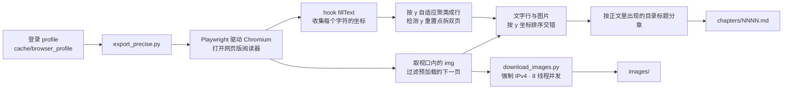

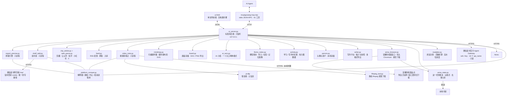

抓取引擎中几个关键决定及其原因：

- **分章依据为「正文中实际绘制的目录标题」**，不使用顶栏标题。顶栏每翻一页都会变化，早期版本因此将整批内容归到同一标题下，其余小节只剩空壳；目录标题每个只出现一次，天然去重。
- **翻页只使用方向键，不点击正文中心**。点击会触发微信读书的「回到上次阅读位置」，而从目录跳到开头不会更新阅读记录，导致「点击 → 等待 → 跳回开头」无法收敛，表现为开头数章整片丢失。
- **每轮翻页设硬超时**。Playwright 的 `page.evaluate` 默认无超时，渲染进程卡死时调用永久挂起；`asyncio.wait_for` 对不响应取消的调用无效，因此使用 `asyncio.wait` 取得超时后直接返回，再终止浏览器回收连接。
- **图片下载强制 IPv4**。macOS 上 urllib 默认先尝试 IPv6，路由不通时每张图约卡 120 秒。
- **订阅源判定只认「根元素就是 feed」**。博客页脚常夹一块创作共用的 `<rdf:RDF>` 授权声明（还裹在 HTML 注释里），见着 `<rdf` 就当 RSS，会把整页 HTML 认成订阅源，反而把页面里 `<link alternate>` 指着的真源挡在后面用不上。判据改为：feed 的根元素之前不先出现 `<!doctype` / `<html`。
- **知乎 / 小红书 / X 各走各的取法，不进通用解析器**。X 的正文根本不在页面里（得问 syndication 那个公开接口），小红书把正文塞进 `<script>` 里的一坨 `window.__INITIAL_STATE__`，知乎对未登录读者时而给正文、时而给验证页。这些差异属于「同一个站一种取法」，塞进通用解析器会改坏所有站点的剪藏，因此独立成模块；哪一家改版失效，只动那一段，并在注释里写清现状，不留一个看着正常、其实永远抛错的空壳。
- **视频只转用户点的那一 P**。多 P 视频整条转可能几小时，而用户要的多半只是其中一集；认链接时先把分 P 列出来，只把选中那一 P 交给 yt-dlp。音频只在临时目录里存在，转完即删——用户要的是那本书，不是那段音轨。
- **云端转写点名就点名**。老配置里若还写着 `mlx` / `faster`，不静默当云端用，而是当面报「本地转写已移除，去设置里填云端地址」——把「我要用大模型」悄悄换成别的，比报错更让人火大。
- **改转写永远先取无筛法的全量**。后端那个写口是整本覆盖的，而界面上常常带着一个筛子（筛一个词只为改那一两句）。保存如果拿「当前看见的那几段」去写，整本转写就改剩那几段。因此保存 = 取全量 → 按 id 合改动 → 整体写回，前端只交「改了哪几段 / 删了哪几段 / 在哪段后面插一段」。MCP 那一层同理包住了 `map_save` 与 `board_save`：不给 `nodes` 就只改标题与形态，不带 `canvas` 就不动画面——用户手画的图和涂鸦覆盖不了第二次。
- **导图的坐标必须在服务端算完**。命令行、MCP 适配器和 `tests/` 里的自测都没有浏览器，却都要能出图；前端若自己再排一遍就是两份真相，存回去的坐标和屏幕上看见的会越用越歪。前端只管照 `boxes` / `edges` 画、把编辑动作回传。
- **画板存 JSON，不存图片**。JSON 是真相（随时能再编辑），SVG / PNG 只是导出物；后端一行不解析 canvas 里那一坨，`board.py` 只把它当数据落进书目录的 `boards/<id>.json`，于是 fabric 的版本、对象和路径随它去。路径纪律也只有一个地方要审：板 id 一律先过 `slug()`，产物只能落在 `boards/` 下面。
- **数据跟着书走，不进数据库**。`notes.json` / `notes.md` / `mindmap.svg` / `mindmap.json` / `boards/` 全部写在那一本书自己的目录里；拷走这本书等于拷走它所有的笔记与画板。手画的那张（`mindmap.json`）和按大纲现算的那张（`mindmap.svg`）是两个文件名，各写各的——自动图冲掉手画图是这一轮最不能接受的事故。
- **后端换不换，看代码指纹而不是端口号**。`/api/state` 里那个 `code` 是 `ui_server.py` 源码的 SHA-1 前 12 位，界面、启动脚本、MCP 适配器、macOS 壳问的都是同一句「你跑的是哪一份代码」，于是一台机器上不会出现两个都觉得自己该起的进程。判出来四种结果：`reuse`（就是这份，直接用）、`takeover`（是自家旧后端且闲着，停掉它、新进程绑回同一个端口）、`busy`（旧后端正在跑任务，绝不打断）、`stranger`（端口上是别人的程序，一个字节都不动）。接管只在「回话里带着归藏自己的身份」与「此刻没在跑任务」两条同时成立时才做，缺一条就退回报错，不硬来。
- **判「后端旧不旧」不能只比版本号**。`/api/state` 除了报进程里那份代码的指纹，还报**磁盘上这份**的指纹（`code_disk`，按 mtime + 大小缓存，不每问重算）。两者不一样就是「改过源码没重启」——这时两边版本号可能一模一样，只比版本号会一声不吭，界面少了的新东西看着像凭空消失。1.0.7 就是这么补上的：这一种情形横幅照样出现、照样给「换新后端」那一条出路，只是那句说的是「本机跑着的后端比磁盘上那份旧」。

## 仓库结构

```
仓库根      运行期代码：后端 ui_server.py、界面 ui.html、引擎与各功能模块
            （取书 export_precise.py、安娜的档案 anna_browser.py / anna_state.py、
              剪藏 clip_article.py / web_parse.py、
              订阅 feed.py、视频 video_note.py / ffmpeg_tool.py、
              内置浏览器 web_browse.py、
              导图 mindmap.py、画板 board.py、小结 ai_sum.py、
              便签 flomo_notes.py、写作 writer.py、阅读计划 readplan.py、
              时长账 activity.py、个人资料 person.py、
              书库目录结构 book_layout.py）
            —— 这一层刻意不分包：任务子进程以数据目录为工作目录，靠
               dirname(__file__) 找同伴模块，移动即断
tests/      验证门禁。一条命令跑全套：bash tests/run_all.sh（--fast 只跑静态检查）
tools/      只在开发机上跑：出图标、打源码包、窗口截图
docs/       四份文档：部署说明、架构与模块地图、开发规范、交接说明
shell/      原生壳与打包脚本：macOS 是 Swift 外壳 → dist/归藏.app → 安装包/*.dmg
            （shell/windows/ 下是 Windows 的入口：安装归藏.bat、启动归藏.bat
              的图标与必读 → 安装包/归藏-Windows-*.zip）
mcp/        MCP stdio 适配器：把本地接口包成 61 个工具给 Agent 用
skills/     给 Agent 看的说明书（不含可执行逻辑）
vendor/     随包的三方前端库（markdown-it、fabric.js）及其 LICENSE，界面不连 CDN
安装包/     只保留最新那一份：macOS 的 dmg + Windows 的 zip
```

| 文档 | 什么时候看 |
| --- | --- |
| [部署说明.md](docs/部署说明.md) | 装、跑、排障、接 MCP |
| [架构与模块地图.md](docs/架构与模块地图.md) | 动手改代码之前：谁调谁、数据落在哪、两套书籍 id、加一个功能的最短路径 |
| [开发规范.md](docs/开发规范.md) | 提改动之前：目录与路径契约、哪些事实只准写一处、界面零 emoji、隐私红线、验证门禁与发版流程 |
| [交接说明.md](docs/交接说明.md) | 接手这个项目时：这一轮修了什么、每个 bug 的根因在哪、还差哪些没验过 |

## 常见问题

**点击「连接账号」或某个按钮没有反应。**
查看启动服务的窗口，它会打印实际的「解释器」与「浏览器」路径，这两行是排查起点。真实出错时后端不会掐断连接，而是将异常与最后几行栈写入界面的「进展」栏，页面同时显示红字。

**点了画板、思维导图或导入 flomo 包，页顶说「界面是新的、后端是旧的」。**
界面是从磁盘现读的，路由表却是后端进程起来那一刻装进内存的。源码目录刚 `git pull` 过、或者旧窗口还开着的时候，就会出现「页面已经是新版、正在应答的那个进程还是旧版」——旧版没长这些接口，一律回 404，看着像后端没启动。点页顶那颗「换新后端」，旧进程退出、新进程绑回同一个端口，页面自己刷新。横幅上写的两串版本号就是答案本身：一致说明这一条接口确实没有，不一致就是后端该换了。旧后端正在跑任务时它不会动手，会写清楚「不打断它」。

**加书架失败，提示「登录超时」。**
网页端 `/mp/` 接口校验两个 cookie：`wr_vid`（长期身份）与 `wr_skey`（约 30 天会话）。`wr_skey` 过期时服务端返回 **HTTP 200**，内容为 `{"errcode":-2012,"errmsg":"登录超时"}`。用同一 profile 打开任意微信读书页面，服务端会重新下发 `wr_skey`；脚本也会自动续期一次后重发。请照抄服务端 `errmsg`，不要推测码值含义。

**取书中途停止响应。**
每轮翻页有 45 秒硬超时，超时后重开浏览器续传，不会整场报废。需要更多信息时，设 `EXPORT_DEBUG=1` 每 60 秒输出一次 Python 栈；日志每 10 页有一次心跳。会话切换时可能有数十秒无响应，属设计内行为（判定 12 页无新内容并重开浏览器）。

**导出的章节数少于目录。**
正文依赖 hook Canvas 取字，阅读器会复用已绘制的缓存，因此整本抓取不保证 100%。引擎已按目录标题分章并支持断点续传，再运行一次通常可补齐。

**书架为空。**
未填写接口 Key。填写后书架、笔记、统计、推荐都会出现；未填写时本地已导出的书仍会列出。

**在搜索引擎中搜不到本项目。**
仓库名为 `weread-guizang`，项目名为「归藏」。

## 已知限制

- 取微信读书的书需要有效账号，且对目标书有阅读权限（无限卡或已购买）；剪藏、RSS 订阅、视频转笔记三条不用登录微信读书。
- 部分出版社限制网页端阅读（显示「去 App 阅读」），此类书无法导出。
- 抓取不保证 100%：阅读器会复用已绘制的缓存，部分页确实不触发 `fillText`；章节归属在两次导出之间可能略有差异（绘制批次不同），但正文总量稳定。
- 纯图廊章节图片密集时，图注与图的配对偶尔相差一位；正文章节中图片相对段落的位置准确。
- 导出速度约每页 1.1 秒（同一本书 14 页 A/B 实测：固定等待 2.12s/页 → 画完即走 1.08s/页，逐页正文 14/14 一致）。继续压缩需缩短「等待本屏画完」的判定，会开始丢字。
- Canvas 逐字抓取对跨行断字仍会丢失少量字符（如 `multi-agent` 被截为 `ulti`）。
- 官方 Gateway 不开放「书单」接口，面板中没有书单，最接近的是「推荐」。
- flomo 请求格式官方未提供示例，此处按通行约定发送 JSON，失败时回退为表单编码；**真实发送未经过验证**。
- 便签这一格是**只进不出**：认 flomo 官方导出包（zip / 两个 JSON 都收），存进本机账后不再往 flomo 回写，也不做双向同步——改了本机的条目，flomo 那边还是老的。导入按「时间 + 正文」认人，重复导同一个包不会翻倍。
- AI 小结依赖你自己填的兼容 OpenAI 接口，没填时那两枚芯片会如实说没配：总结不产生假内容，也不会替你猜。
- 阅读划句翻译 / 查词 / 问助手依赖你自己填的兼容 OpenAI 接口。返回结构按几种常见形状解析（标准流式 `delta`、只发 `finish_reason` 不发 `[DONE]`、整段 JSON、SSE 里给 `message` 不给 `delta`），**未对具体厂商逐一联调**；遇到全都对不上的私有格式仍可能失败，那时它会如实报错、不编内容。
- 内置浏览器是「本机取回、界面里看」这条尽力路线：能绕开 `X-Frame-Options` / CSP 的嵌入门槛，但**不带登录态**（不写盘、不留 cookie），只认 `http` / `https` 且拒绝本机与内网地址，也**不代理 WebSocket / 流式媒体**。要登录、要过验证的站点（如安娜的档案下载页）请走弹出窗口那条路。
- 知乎 / 小红书 / X 的解析依赖对方「现在」怎么发页面，随时可能失效。未登录时知乎与小红书多数情况只回验证页，这是平台限制，不是可以绕过的 bug——归藏选择如实报错，不做登录态绕过（也就没有你的 cookie 上传问题）。
- RSS 只做「订阅 → 读 → 入书架」这条最小闭环：不做已读/未读同步、不做双向同步、不在后台定时轮询（要新内容时点一下刷新）。
- 视频转笔记目前只支持 B 站与 YouTube。转写走你自己填的云端接口（兼容 OpenAI 的 `/audio/transcriptions`），专有名词、多人对话、强口音的准确度取决于你选的那个模型，不保证。转写只走云端：本机不装引擎、不下权重，也就没有那几个 GB 要管。
- 云端转写只填域名也行：归藏会补成 `<你填的地址>/v1/audio/transcriptions`（填到 `/v1` 就补后半段，已经是完整端点就原样用）。地址填错或连不通时，任务会如实报错、视频页那盏灯也会写清原因，不会假装在转。
- macOS 才会自动下载 ffmpeg（下的是静态版，放在归藏自己的数据目录里、不动系统）。Windows / Linux 请自己装一份放进 `PATH`。
- yt-dlp 属于「随平台改版天天要更新」的工具：视频取不到时先 `.venv/bin/pip install -U yt-dlp` 再试一次。
- 视频的 AI 笔记与思维导图依赖你自己填的兼容 OpenAI 接口；没填时就只存转写全文——这是有意为之，不在你没配的情况下把音频或文字发给第三方。
- 云同步按 WebDAV 与 Microsoft Graph 的公开接口实现；**未在真实网盘账号上端到端验证**，首次同步建议先用一本小书试通，确认无误再同步全部。
- 「换新后端」这一键是在**手搓的旧版后端**上验的：一个自报旧版本号、没有新接口的进程，换班成功、旧后端正在跑任务时不打断、端口上站着别人家程序时不动手，三条都摆成了可失败的断言；**没有在你从前跑过的那个真旧实例上走过一遍**。万一没换成，横幅会说是哪种原因，退出归藏再打开一次同样能到新代码。
- 跨平台：Windows 这一路写了安装脚本、启动脚本，也在单元测试里以 mock 的平台标志跑过，但**没有在真实 Windows 机器上端到端跑过一遍**。上面那个 Windows zip 就是这么打出来的（打包机是 macOS，做不出真 .exe）；装与跑的结果还没人见过——跑到哪一步卡住，都请当它是「第一次跑」，报错窗口里最后几行最有用。
- 写作助手（续写 / 灵感 / 润色）与阅读助手走同一个兼容 OpenAI 接口，没填时按钮如实说没配；**未对具体厂商逐一联调**。稿子的图片 / PDF 导出走随包 Chromium 渲染，EPUB 与 Markdown 由标准库直接写出，不引第三方排版库。
- 随时长账（学习 / 写作两张热力图）的停靠口径：学习时长按应用在后台运行的累计秒数记，写作时长按停在写作页的累计秒数记，都靠界面心跳上报，**没有在长时间挂机场景下核过对**。
- 「安娜的档案」这一路依赖对方站点**现在**怎么服务，而它一直在动：2026-10-07 在有头窗口里实测，只有 `annas-archive.is` 这个域答话（`.gd` 回 502、`.org` 与 `.se` 直连不通），域名字面还在轮换——失效时在这一栏填一个新镜像就行，不用改代码。国内访问借你本机现有的代理，代理不通时那句人话会点出来。
- 对方**现在要求登录才给下载**：详情页每个下载钮都先跳 `/account`。所以第一次得在那个窗口里自己登一次，登录态只留在本机那个浏览器档案里；归藏不代填表单、不读它的 cookie。
- 这一栏**嵌不进界面**：对方响应头写着 `X-Frame-Options: SAMEORIGIN`，iframe 一律空白，所以做成工具自己开的窗口。
- 只收阅读器读得动的格式（EPUB / PDF / TXT / MD）：MOBI、AZW3、DJVU 不入库，原文件留在下载夹里不动，那一行下面写清为什么没收。**下载成功率不做保证**——受账号额度、条目本身有没有可下载文件、镜像可用性影响。
- 「接住下载 → 转成书 → 上本地书架」这一段在沙盒里端到端跑过（含不覆盖同名、按内容指纹去重、格式不认的兜底），但**没有在你的真账号上走过一遍**：真下第一本要在窗口里登录之后才算完全验过。
- 那个窗口最长活 4 小时就自己收摊，免得留一个占着任务槽的僵尸窗口；要接着用再搜一次（窗口会重新领起来）。
- 阅读计划的「页」是按正文**每 1000 字**折算的，不是纸书的物理页数；进度取**只增不减的高水位**，所以翻回前面重读不会把今日读数减下去。读完的留档每本书最多留 **40** 条，超出后最旧的会被挤掉。

## 来源与许可

抓取引擎（`export_precise.py`、`download_images.py`）来自 [lbq110/weread-exporter](https://github.com/lbq110/weread-exporter)，在此之上做了二次开发。

**上游仓库未声明任何开源许可证。** 因此这里不替上游做授权决定：上述文件的著作权与授权状态以上游为准；如需再分发或商用，请先向上游确认。

归藏新增的部分——`ui_server.py`、`ui.html`、`mcp/guizang-mcp.mjs`、`platform_compat.py`、`shelf_add.py`、`login.py`、`writer.py`、`activity.py`、`person.py`、`skills/`、`tools/`、`tests/`、`docs/`、启动脚本与文档——按 **MIT** 使用。

仓库根目录**刻意不放 `LICENSE` 文件**：一份根 LICENSE 会覆盖整个仓库，而上游代码的授权不由此处决定。待上游明确授权后，再补充合适的许可证。

## 免责声明

仅供个人学习研究及备份**自己已购**的内容使用。请勿传播导出成果，勿用于商业用途，尊重著作权与平台服务条款。工具只监听本机回环地址，不会把账号、Key 或书籍内容发往任何第三方服务器——**往外的连接只有你自己点名的那几处**：划句翻译 / 问助手会把你选中的那段发给你在设置里填的 AI 接口，视频转笔记在选了云端转写时会把音频发给你填的转写接口、在填了 AI 接口时会把转写文本交给它做总结，「安娜的档案」那一栏只连安娜的档案自己的站点（借你本机现有的代理，而且是**你自己在那个窗口里浏览与下载**）。这些地址都由你自己填写或自己点开，归藏不预置、不代传。
